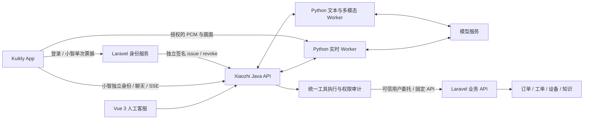

# Xiaozhi Agent 主服务与 Laravel 身份、业务边界规划

日期：2026-11-01。状态：根据当前源码制定的后续架构与开发计划，尚未实现 Agent 工具闭环。与 [Android 联合接入需求](KUIKLY_ANDROID_INTEGRATION_PLAN_20261101.md) 配套；不替换或简化原始完整规划。

## 1. 目标与结论

采用 **Laravel 作为身份和业务权威，Xiaozhi Server 作为统一 AI 与协作服务** 的架构。新接入 App 的 AI 文字、附件理解、实时语音和画面、工具调用、历史、人工客服、专家协作均在 Server 编排和回复；需要业务事实时，由 Server 通过受用户委托的 API 查询 Laravel 或其他已授权来源。

“Laravel 仅做身份验证”在 AI 链路上的含义是：Laravel 不再承担新会话的模型调用、提示词、AI 流式回复和 Agent 编排。但 Laravel 仍保留自己的业务数据库、权限、业务规则和业务 API；每次委托查询仍需验证当前用户能否访问具体订单、设备或知识。登录通过不等于可以读取该租户全部数据。

App 原有非 AI 业务页面继续使用 Laravel API；旧 AI 历史与旧 Aimeet 入口在迁移期间保留。新小智会话不同时调用 Laravel 旧 AI 回复端点，超时也不能跨提供方自动重发，避免重复回答与身份错配。

## 2. 职责和系统结构

| 层 | 权威职责 | 需要保留的边界 |
| --- | --- | --- |
| Kuikly Android / 后续其他客户端 | 原生聊天、上传、音视频采集/播放、用户确认与结果展示 | 不保管模型/服务签名密钥，不自行决定租户或资源授权，不直接执行模型给出的 URL/SQL |
| Laravel | 用户登录、有效来源会话、组织/租户/项目成员关系、业务记录和业务规则、票据签发及撤销 | 不复制一套新 AI 会话或模型执行；业务 API 每次复核委托用户和资源权限 |
| Java API / MySQL | 会话和消息账本、外部来源授权、人工分配、工具目录/策略/执行、审批、审计和事件 | 工具执行只接受可信上下文与注册工具；不因模型参数自报 user_id、tenant_id 或角色而授权 |
| Python AI / 实时 Worker | 模型适配、流式文本/音频、解析结构化工具提议、回填已确认工具结果 | 不直接查询 Laravel 数据库，不持有来源业务签名密钥，不绕过 Java 授权执行工具 |
| Laravel / IoT / 知识等来源适配器 | 固定接口映射、字段裁剪、结果校验与来源证据 | 对外隐藏内部服务凭据，禁止通用 HTTP 代理或任意 SQL/脚本执行 |

模型服务仍可以是百炼等已有提供方；“统一在当前项目”指会话、权限、工具、回复和运维入口统一，不要求把模型推理部署在本机。

## 3. 一次业务查询如何完成

以“查一下我这张工单现在谁在处理”为例：

1. App 将问题和稳定 `client_message_id` 发到小智会话；Java 保存用户消息，建立绑定本轮来源授权的 AI run。
2. Server 只向模型提供当前允许的工具声明；模型提出 `get_work_order({work_order_id})`。ID 缺失或存在歧义时先询问用户，不猜一个工单。
3. Java 工具服务从该 run 的可信绑定恢复来源用户、tenant、scope、具体 Bearer/来源会话，重新鉴权并校验参数；不接受模型指定调用身份。
4. 复用签名只读 adapter 调 Laravel 的固定委托查询入口。Laravel 再确认当前登录会话、成员关系及工单归属，输出允许字段及真实记录 ID、观察时间和来源证明。
5. Java 校验响应、来源和授权仍有效，持久化工具结果与执行状态；业务正文只以工具数据进入模型上下文，不能提升为 system 指令。
6. 模型根据结果生成答复，经原有持久化/SSE 或实时音频通道回复。界面可展开数据来源、查询时间和真实工单引用，原会话 ID 不变。
7. 来源拒绝、超时、未配置或查询无结果分别提示，不用模型生成的状态替代业务事实。中途转人工、取消、撤权或 epoch 变化后，迟到结果不得推进旧模型回答或公开到新上下文。

订单、工单是不同业务实体。现有 adapter 的 `work_order` 不自动覆盖销售/服务订单；具体订单类型和接口字段在对应来源接入时冻结。

## 4. Function Call、工具与技能的关系

- **工具 Tool / Function**：一个有明确输入、输出和权限规则的动作，例如查询工单、查询设备、检索知识。模型选择名称和业务参数，Server 负责执行和校验。
- **技能 Skill**：经版本管理的领域流程，例如“冷库故障初查”：补充设备信息→查询设备及报警→检索知识→给出有来源的检查建议→需要时转人工。技能复用工具，不增加调用者权限。
- **MCP**：后续可用于接入额外工具服务的协议方式。首期直接用当前固定 HTTP adapter 和统一工具目录，不必先把 Laravel 改成 MCP Server。将来增加 MCP 也必须经过同一授权、审计和审批层，不能让模型直接携管理员凭据访问业务 MCP。

同一技能应能被文字和实时语音使用，区别只在输入/输出通道；不要在 Laravel、Python 文本 Worker、实时 Worker 和 App 分别维护四套业务逻辑。

### 首批工具建议

以下名称是拟议的模型工具名称，不是已开放的 HTTP 路由。

| 工具 | 类型 | 来源与当前基础 | 首批范围 |
| --- | --- | --- | --- |
| `get_device` | 只读 | 现有 `device` adapter；真实来源待接 | 设备档案与可核验的归属/项目 |
| `get_work_order` | 只读 | 现有 `work_order` adapter；真实来源待接 | 具体工单详情、状态和当前处理信息，字段由来源授权裁剪 |
| `search_knowledge` | 只读 | 现有 `knowledge` adapter；真实来源待接 | 当前用户有权查看的内容，逐条保留引用 |
| `search_orders` / `get_order` | 只读 | 当前 adapter 尚不支持 | 先明确订单类型，新增有界筛选、分页和详情协议 |
| `get_device_telemetry` / `list_device_alarms` | 只读 | 当前设备档案不等于传感器/报警接口 | 真实采样时间、单位、数据来源和陈旧标记 |
| `prepare_work_order` | 本地草稿 | 待开发 | 提取用户确认过的事实，草稿不表示工单已创建 |
| `submit_work_order` | 业务写入 | 待开发，后续阶段 | 用户确认、业务权限、幂等键和来源业务事务同时满足才提交 |
| 转人工 | 会话控制 | 现有 handoff 可复用，Agent 触发需新增策略 | 先走建议/明确请求；不因业务工具失败悄悄更换身份或接收方 |

取消订单、退款、派单、权限变更等有业务后果的操作分别评审。既有首期约束继续适用：AI 不自动执行危险设备控制；不能因为工具底座完成就开放设备开停机等动作。

## 5. 统一工具执行底座的设计

### 工具目录与权限

每个注册工具包含稳定名称、版本、输入/输出 JSON Schema、操作类别（只读/草稿/写入）、固定 adapter、授权策略、超时、结果/分页上限、幂等策略、审计与确认要求。模型参数只包含业务查询条件，不包含可信 user/tenant/source/角色/密钥，也不能提供目标 URL 或自定义 HTTP header。

工具清单由服务端按账号、来源、租户、scope、功能开关和模型能力选择；执行时仍完整复核，不能只靠“模型没看见该工具”作为权限控制。本地管理账号没有 Laravel 委托时，不得退回全局服务账号查询任意业务。

### 授权绑定与撤销

现有 B6 adapter 接收可信 Principal 并在外部请求前后重验 Bearer。新的异步工具链也要把来源/Bearer 绑定持久化到 run/工具授权记录：不能仅凭本地 owner ID、旧 scope 快照或 Worker 自报的来源恢复执行权限。

每次工具派发、业务响应接收、模型回填与向客户发布结果前核对当前 run/attempt/lease/control_epoch、来源会话、具体 Bearer、账号和资源授权。来源真实成员/资源权限仍由 Laravel 在每次业务查询时复核。用户切租户不复用另一租户的运行上下文。

外部 Bearer 当前默认 300 秒、最长可配置 900 秒，且无绕过来源的 refresh；长工具流程或实时通话需先处理到期与续授权设计，不能新发 Bearer 后接管旧授权绑定。来源撤销应有可靠投递；本地授权检查不意味着网络故障下跨系统瞬时撤销。

### 执行、结果与可恢复性

- 规划新增工具调用与尝试记录，关联 conversation、run/实时 response、provider call ID、工具版本、输入摘要、授权绑定、epoch、状态、来源引用、错误和真实耗时；仅保存必要业务数据。具体表名/字段另冻结，本文不创建表。
- 状态至少区分已提议、待确认、待执行、执行中、成功、失败、取消、过期、结果不确定。网络 IO 在短事务外执行，CAS/lease 防止并发派发；幂等键与请求摘要绑定，重试不改参数或执行身份。
- 只读查询可在仍获授权和总预算内有限重试；写操作超时后先查业务执行状态，不盲目再提交，也不能仅凭本地幂等宣称第三方“恰好一次”。
- 结果保留真实来源、资源 ID、采样/观察时间、接收时间、单位、是否陈旧、截断与分页信息；空结果、无权限、来源未配置和故障分别表示。
- 返回给模型的内容做字段白名单、敏感信息裁剪和大小限制。业务备注、知识内容属于外部数据，里面的“忽略权限/换工具/上传全部资料”等指令不得改变工具策略。
- 工具结果放入专门的调用账本和合法 tool 上下文，不伪装成用户消息或专家核验事实；必要的结果摘要/引用通过已授权的消息 parts 或事件展示。换账号、撤权和历史客服 cutoff 同样约束结果查看。
- 多轮工具调用设置最大轮次、调用次数、总耗时、模型上下文和费用预算；初期采用少量串行调用，有证据证明互不依赖时再有限并发。超预算给出明确未完成结果。

业务数据仍以 Laravel 为权威；Server 为对话审计保存的必要结果快照不成为一份可任意跨用户复用的业务主库。缓存按来源、用户、租户、授权范围和查询隔离，权限变化后重验；不将工具结果写入无权限隔离的公共长期记忆。

## 6. 模型接入：文字优先，实时复用同一工具服务

### 普通文字与多模态

当前 `ai_worker/provider.py` 只请求内容流，`worker.py` 读取 delta.content，Java Task/ContextMessage 也没有工具提议与结果结构。需要扩展：工具清单→流式参数归并与完整 JSON 校验→Java 持久受理工具提议→执行→按 provider call ID 回填 tool 结果→继续模型生成。不能用提示词要求模型输出一段 JSON 就当作权限受控的执行链。

内部协议只追加经过独立 Worker 鉴权的精确方法，绑定 run/response、attempt、lease 与 epoch，不开放通用执行端点给 App。模型多次请求的真实 usage 分次留存并汇总；等待工具不是最终回答，不能提前把原 assistant 占位标 completed。

### 实时语音

现有实时配置 `tools: []`，并将 function_call/MCP 事件拒绝为 `UNSUPPORTED_TOOL`。这是当前实现边界，需要新增事件白名单、call ID/response 绑定、工具执行 ACK、失败与取消状态、结果回填和续答；不能只删除拒绝分支或把内部业务 key 发给模型。

阿里云现行官方文档确认 Qwen3.8-Omni-Flash-Realtime 支持 Function Calling；结果用 `conversation.item.create` 的 `function_call_output` 回填，再按官方流程续答。模型支持不代表本 Worker 已接入或当前部署已实测，新增能力仍需真实 provider 验证。

实时场景共用 Java 工具服务，查询时可播报“正在查询”，但确认业务结果前不宣读虚构状态；用户新发言、打断、转人工或撤销后，旧工具的迟到结果不能继续旧语音回复。只读调用可能已经完成，保留审计，但不以此自动发起下一轮或跨会话播报。

## 7. Laravel 需要提供什么

1. **身份生产者**：已有登录流程之外，新增小智独立单次票据申请，可信 subject/source_session/tenant/scope 构造，独立签名 issue 和可靠 revoke。不能把 App 自报项目列表签名后视为已授权。
2. **固定只读委托入口**：优先按 [B6 只读协议](B6_READONLY_HTTP_PROTOCOL.md) 实现现有 device/work_order/knowledge 操作；来源端复用自己的业务权限服务，输出最小字段、真实记录/项目和签名响应。不让 Server 直连 Laravel 业务数据库。
3. **后续业务查询扩展**：订单搜索/详情、遥测/报警等新增版本与 Schema，区分资源类型、分页、状态枚举、单位、时间和无权限语义。不要把 UI 原有大响应不加裁剪地全部送给模型。
4. **后续写入接口**：仅在用户确认流程就绪后增加工单提交等，提供业务幂等、状态查询、版本冲突和审计；业务状态机、金额/库存/调度规则继续在 Laravel 执行。

不需要 Laravel 提供新的 AI chat/send、模型代理、提示词维护或媒体通道。App 上的 AI 新功能只对接 Server；业务调用的编排放在 Server。

## 8. 当前基础、缺口和分期

| 阶段 | Server 工作 | Laravel 工作 | App 工作与验收 |
| --- | --- | --- | --- |
| A / P0：身份和单一会话入口 | 配置外部来源与可达 API/worker/媒体入口，保持原服务兼容 | 单次票据签发、可信租户/scope、撤销投递 | 独立小智 client；新 AI 会话统一直达 Server，旧历史保留 |
| B / P0：工具执行底座与文字闭环 | 工具目录/Schema、来源绑定、调用账本、Worker 协议、只读执行与结果回填、SSE 状态/引用 | 对齐固定委托入口；真实端点暂缺时不启用生产工具 | 展示查询中/成功/失败/引用，验收文字查询真实业务 |
| C / P1：三类真实只读工具 | 将 get_device/get_work_order/search_knowledge 接到已有 adapter，补端到端权限和撤销验证 | 实现三个真实 producer 操作 | 用授权的真实用户、租户和记录验证，不能以 mock 当真实业务联通 |
| D / P1：实时工具和领域技能 | P3 工具事件/ACK/回填/取消/usage；文字与语音共用工具策略；版本化故障初查技能 | 复用同一只读 API，不增语音专用业务逻辑 | 原生音频链路、工具状态与真人语音查询；打断、过期、转人工不串答 |
| E / P2：更多业务与受控写入 | 订单/报警扩展，草稿→确认→提交，参数摘要绑定与不确定结果恢复 | 查询、提交及状态核对等真实 API 和业务规则 | 展示事实与草稿、明确确认与业务结果；写入不能仅凭模型声称成功 |

当前已完成的是会话/多模态/人工媒体基础、B6 外部身份和固定只读 HTTP 客户端。上述工具目录、模型执行循环、持久工具账本、Laravel producer 和真实业务闭环均仍待开发。没有真实业务 API 时可先做 B 阶段的协议、隔离测试和故障注入，功能默认关闭，不能虚构订单或设备答案。

阶段 B 可拆为 Java 工具执行、Python 模型适配、Vue/App 状态展示三个独立模块并行开发；阶段 D 在同一工具契约稳定后扩展实时 Worker。按用户偏好，大模块使用 6.1 Sol，小的 DTO/契约测试/文档任务使用 6.1 Terra；本次仅分析规划，不新派发开发代理。

## 9. 核心验收标准

- [ ] 一次真实登录后，新 AI 文字、图片、语音和人工协作都使用小智会话；Laravel 没有被额外调用来生成第二份 AI 回复。
- [ ] 自然语言查询触发真实 tool call、经过 Java 与来源双重授权、得到真实记录并回填模型；不需要业务数据的问题不额外查询全部订单。
- [ ] 跨用户/租户/项目、模型伪造身份、任意 URL/工具名、业务内容提示注入、已撤销/过期 Bearer 均不能获得越权数据或执行。
- [ ] 等待工具时发生取消、新用户输入、转人工、Worker 失租/重启或来源撤销，旧结果不进入新回答；保留真实尝试和结果不确定状态。
- [ ] 失败、无记录、无权限、超时、限流、未配置、陈旧值、部分结果各有真实状态；有来源、时间与可访问引用，不伪造实时数据或真实 usage。
- [ ] 写入确认与账号/租户/工具/版本/参数摘要/有效期绑定；参数变更重新确认，网络失败不重复提交，不把本地草稿称为已创建工单。
- [ ] 实时语音使用同一组业务工具，查询、续答、打断、长流程授权和媒体生命周期均有真实 Android/provider 双端证据。

数据库只做后续可审查的增量迁移，保留现有账号、消息、证据和失败记录；不删除、清空、重新初始化现有数据库或覆盖旧业务数据。当前规划没有变更运行配置、开关、数据库或执行任何业务写入。

## 10. 核对依据

本仓：`modules/externalidentity/ExternalBusinessAdapter.java`、`ExternalBusinessController.java`、`ExternalBusinessHttpAdapter.java`、`modules/ai/AiModels.java`、`AiExecutionService.java`（均位于 `main/manager-api/src/main/java/xiaozhi/`）；`main/xiaozhi-server/ai_worker/provider.py`、`worker.py`；`main/xiaozhi-server/realtime_worker/provider.py`、`session.py`。

身份与业务契约：[B6 身份](B6_IMPLEMENTATION_CONTRACT.md)、[B6 只读来源协议](B6_READONLY_HTTP_PROTOCOL.md)、[外部媒体/VAD](EXTERNAL_MEDIA_VAD_OPERATIONS.md)。模型能力核对日期 2026-11-01：[阿里云 Function Calling](https://help.aliyun.com/zh/model-studio/qwen-function-calling)、[Qwen-Omni-Realtime](https://help.aliyun.com/zh/model-studio/realtime)。官方模型能力与当前 Worker 已实现范围分开判断。
