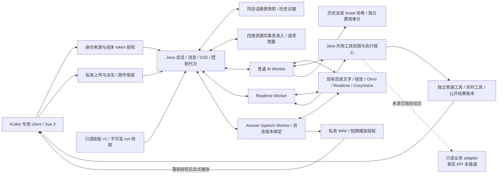

# 全 AI 首批开发与验证记录

日期：2026-11-02。分支：`Dev`；开工提交 `d82a1c7`。本文件记录代码、隔离技术验证与原 Dev 部署，保留 [完整开发计划](AI_FIRST_INTEGRATION_PLAN_20261102.md) 的范围与验收标准。A0～A7 已实现并显式部署；本轮 A5/A6 完整浏览器交互及 A8 受控故障验证已完成，终版长测按用户要求停止追加验收，实际约20分钟因上游 PROVIDER_ERROR 结束，未记30分钟通过。真实终端、身份来源与业务验收单列。下方历史阶段证据完整保留，最新结论见末节。本地共享工作树同时有独立 ESP32 支线，未将混合未提交改动直接推送。

## 交付范围

| 批次 | 实现与验证 | 边界 |
| --- | --- | --- |
| A0 | 配置能力矩阵、输入/输出限额、公开结果与引用、严格公开契约、显式开关 | 配置不等于 provider 健康或生产验收 |
| A1 | Kuikly 独立 client/API/Repository/页面，按环境/来源/租户/账号隔离；消息、SSE、草稿、取消重试、登出 | 实际 Server + 共享 client JVM 联调通过；原生网络桥、真实票据生产者/续期 delegate、安全存储与手机采集播放未验收 |
| A2 | 同轮图片和原声 Omni 工具，保留原件与明确输入模态，显式模型允许列表 | 真实 JPEG/录音技术样本通过；不等于全部文档/视频组合或真实故障诊断 |
| A3 | 有界 `extractive_v1` 原文摘录记忆、不可变快照与范围，历史附件按需重取，公开结果按精确来源/token 再授权 | 首版没有把确定性摘录称作模型推理摘要；跨会话记忆不开放 |
| A4 | 共用工具权限核心、独立实时响应/调用/尝试/审计、异步等待、精确结果 ACK 与续答、实际逐 response usage | 真实 RT provider、技术工具与生成媒体通过；手机收音、回声和现场网络未验收 |
| A5 | [实时材料契约](REALTIME_MATERIALS_CONTRACT_20261102.md)、Java/Python/Vue、真实 HTTP/视觉/RT、SQL 及完整浏览器流程 | 生成媒体与独立浏览器已通过；原生手机、物理收音和生产现场另验 |
| A6 | 普通回答私有 TTS、短期播放授权/取消、固定只读技能、工具结果/引用；[公开契约](ANSWER_SPEECH_SKILLS_CONTRACT_20261102.md) | 实际模型、浏览器播放/停止/重播与公开引用已通过；真实扬声器听感和原生手机另验 |
| A7 | 四类资源统一准入、滚动小时请求预算、只读本人额度/用量、受限管理员服务统计；[公开契约](AI_RUNTIME_CONTROL_CONTRACT_20261102.md) | 模型 tokens 与 TTS characters 分开，已知用量是报告下界，不是生产总费用上限 |
| A8 本轮 | 完整浏览器、真实模型与私有材料、受控弱网/断线/取消/撤权/迟到结果；费用历史补记 | 终版长测按用户要求停止追加验收，实际约20分钟因上游 PROVIDER_ERROR 结束，未记30分钟通过；真实业务、安卓/物理声学、公网现场与生产压测单列 |

新增转人工、客服调度与人工工作台扩展继续后移；既有人工入口和数据保留兼容。本期技术验证不调用真实订单/工单/设备业务 API。

## 首批真实技术证据

证据目录：`/path/to/user/code/esp32/work/ai-first-20261102/`。其中私有 runtime/SQL 仅保留本地，不复制到 App、源码或公开日志。

- A2 JPEG：真实 `qwen3.8-flash`，实际 Java `server_capabilities` 执行一次，模型两轮输入/输出/总 token `1029/139/1168`，两条真实 provider usage。
- A2 原声：生成 WAV 真正作为 `input_audio` 送 `qwen3.8-omni-flash`，Java 技术工具执行后续答，`976/293/1269`，其中 input audio token 18；不是 ASR 文本冒充原声理解。
- A4：真实 `qwen3.8-omni-flash-realtime`，音频及受限 JPEG 输入 → Java 工具 → 实际分配 result item 的精确 ACK → 授权续答。收到 296640 字节 PCM；两次 provider response 合计 `2582/111/2693`；SQL 仅一条完成 assistant 消息。公开 `/tool-results` 返回正确 session/response 与来源，`/context` 返回有界摘录快照。
- 汇总：`python-native-media-realtime-summary.json`。A2 和 A4 分别引用各自实际通过的 case，保留早期 timeout 和 provider 事件不兼容的失败现场，不覆盖或把失败记录改成成功。
- App A1：真实 Server 与正式共享 client/API/Repository，test-only HttpURLConnection 代替无法在 JVM 使用的原生 NetworkModule。1 项测试、零跳过、12.4 秒，真实模型完成、15 帧认证 SSE、16 个持久事件、取消重试、4 条历史恢复、草稿隔离、logout 后 `/me` 401。证据 `http-20261102_023715_e842ba/app-integration-test.xml`。这不构成原生桥或手机验收。

首批回归：Java 全量 613 项零失败/零跳过，随后实时正常结束的历史状态窄修另有 1 项真实 MySQL 定向测试；Python AI 73 项、Realtime 66 项零失败/零跳过。A5 后续整合后的最终全量数字另记，不将定向子集重复累计。

## 原 Dev 部署与数据保留（A0～A4 阶段；最终状态见末节）

- API `http://127.0.0.1:18893/xiaozhi`，Vue 3 `http://127.0.0.1:18894/#/conversations`。A0～A4 已显式启用，A5 材料开关此阶段仍关闭。
- 已部署 A0～A4 JAR SHA256：`9a04a8600838ca4f571c48a402d335d7a4d6cd5fd039f977ecbe1b55d40bbe12`，私有回退副本 `a0-a4-reviewed.jar`。
- 开工备份 `dev-before-100157.sql`，SHA256 `56aa84336e1adaf3a0147cc1da8a91971e53b563447558c6916c242202f42ca7`。原 Dev 4 用户、25 条旧历史、37 条消息、122 个 changeset。
- 只做增量迁移，当前 128 个 changeset。并行 ESP32 迁移因 Dev MySQL binlog/trigger 权限失败时，仅 4 张新空表先创建，原数据逐行无变化。新未应用迁移的建表改为可重入；经审查仅对专属 Dev MySQL 临时开启 creator 选项完成触发器迁移，随后还原为 0，没有授予 SUPER，没有删除表、记录、库或卷。恢复记录 `dev-trigger-recovery-105055.json`。
- 新增只读迁移预检，类似权限条件不满足时，在停止 worker、改设置或重建 API 前失败；不自动提升数据库权限。
- 原用户、旧历史和消息逐行字节核对通过。浏览器新增一段明确技术会话及 2 条消息后为 39 条，原 37 条保持原样；记录 `dev-data-preservation-110754.json`。

## Vue 页面验证

使用 ego-browser TaskSpace 44，实际通过 admin 密码登录，创建“全AI工具结果验收-1102”，发送技术工具请求，观察真实回答“协议版本：1，只读模式：是。”；展开结果可见真实成功状态、来源与时间。刷新后保持同一历史和结果。页面 URL/title、非空、无 Vite overlay、当前检查无控制台错误；1440×1000 和 390×844 无横向溢出，窄屏导航隐藏后卡片可读。

- 桌面图：`tool-result-desktop.png`；窄屏收敛图：`tool-result-mobile-settled.png`。
- Vue fixture 全量与构建已通过；A5 引入后最终回归及真实材料页面结果另记。

## 当前范围之外与后续验收

1. A5/A6 完整浏览器流程本轮已补齐；实际扬声器可听性、物理麦克风/摄像头、声学质量与 Android 原生验收仍须真实终端，生成媒体不能替代。
2. 当前本地受控并发、预算、弱网、断线与依赖故障已验证；终版长测按用户要求停止追加验收，实际约20分钟因上游 PROVIDER_ERROR 结束，未记30分钟通过。部署环境整体容量、告警投递、存储留存/恢复演练和生产计费需按具体上线环境另验，未知用量不能按零计费。
3. App 真实票据生产者/续期 delegate、原生网络桥/安全存储、SSO、生产网络与 Laravel 真实业务 API 分别接入；新增人工能力继续后移。

以上是本地可审查交付，不表示混合工作树已提交/推送或生产上线。

## A5 整合补充（历史阶段；最终状态见 A6 节）

- Sol 三路分别负责 Java、Python、Kuikly client 与后续 Vue A5；Terra 负责契约/运维/公开结果卡片。人工扩展未插入本批。
- A5 阶段 Java `-DskipTests=false package`：634 项、0 失败/错误/跳过，新建独立 schema，日志 `full-java-1102_112950_7ed8.log`；包含 A5 9 项真实 MySQL/附件测试、3 项协议测试和新外部路由/XSS 安全测试。
- Python AI 73、Realtime 78；Vue 10 contract + 520 unit、生产构建、六语言各 1937 key；Dev 84、CI 4 均通过。App 初次 1111 项 JVM 与额外真实 client 集成 1 项不与前述数字混加。
- A5 真链路证据 `python-a5-materials-summary.json`：视觉感知 `220/21/241`，RT `1275/151/1426`、465600 字节音频；前后普通文字 run 分别 434/599 token。SQL：1 材料、1 材料 user、0 材料 ai_run、1 RT provider response、1 感知 usage，最终 3 条 completed assistant 为前普通/单 RT/后普通。旧代次材料 context ACK 实际 HTTP 409。
- A5 阶段 Dev JAR SHA256 `3d52c6489185e2ac5afb34891585019c580575dfb99ca22261080880bee0c3e1`，API/AI Worker/Realtime Worker 已恢复，`ai-first-status` 显示上下文/结果/实时工具和材料配置已启用；单独配置状态不替代上述真实验证。
- A5 发布连同共享 ESP32 后续独立增量迁移，原 Dev 122→132 changeset。已应用首个 changeset 保持与原部署包一致，后续列/触发器修正使用新 changeset。没有删除/清空/重建数据库。`dev-trigger-recovery-113228.json` 记录专属 Dev 临时 binlog creator 选项已恢复 0，未授予 SUPER。
- `dev-data-preservation-113258.json` 核对原 4 用户、25 条旧历史、37 条消息逐行字节一致，本轮仅新增 2 条技术消息。原数据库/卷保留，运行参数不含初始化或清空操作。
- A5 页面已观察到新入口、真实 provider ready 与默认设备未开启。Ego TaskSpace 46 出现密集 `hidden=true/false`，按设计停止通话，未绕过停流保护；该空间已正常关闭。改用独立 IAB 页后，用户已当次授权验证码并完成登录；后续音频初始化超时、页面意外重置，未把上传/恢复完整 UI 记为通过。

A0 与 A5 的独立 OpenAPI 已通过 YAML、本地引用、路径数和安全声明检查；本机未安装专用 OpenAPI validator，因此不宣称完整规范验证。

## A6 整合与当时部署（历史阶段；最新状态见末节）

### 普通回答朗读与只读技能

- Java、Python 两路 Sol 继续完成朗读账本、独立 worker、固定技能及真实 provider 验证；Terra 完成 Vue 播放/技能入口、Dev 运维和公开契约，主任务整合权限、迁移、安全与播放互斥。所有新人工扩展继续后移。
- 朗读只接受已完成 assistant 消息 ID，不接受任意文字、模型、音色或 URL；消息原始版本与文本各有独立 SHA-256。队列/合成/取消、精确来源 token、短期授权、私有文件与实际 provider 费用分别记录。服务端逐块重新授权，Vue 下载后再次授权并每 2 秒续期，失效、切身份/会话、隐藏或实时/人工媒体开始时停止，保留显式重播入口。
- 真实 CosyVoice 技术链路得到 WAV **186764 字节、3890ms**，provider 实际 `characters=35`；request ID 未提供时保留 null。输入为明确的技术 assistant fixture，未将其描述成真实 LLM 生成。本轮严格区分真实合成与原生播放验收。
- `materials_guidance`、`evidence_summary` v1 只允许历史/证据两个工具；每个普通 run 捕获不可变技能快照，执行时仍强制工具范围，后续改选/关闭功能不改写已捕获快照。真实 qwen 模型两轮、一次 history 工具、公开来源与快照验证通过，实际 usage **1685 input + 138 output = 1823 token**。
- `python-a6-answer-speech-summary.json` 分别引用真实合成成功项与后续无云调用的撤权/取消验证；初次 harness 误以为 revoke 返回 200、实际 204 的失败现场完整保留。`python-a6-skills-summary.json` 同样保留初次开关关闭出现旧式 HTTP200 错误体的失败记录，修复后独立无云 HTTP 复验六条关闭路由返回真实 404，不重复制造模型费用。
- 最终修复还包括：A5/A6 关闭状态控制器保留映射，由服务显式返回 404；Job 数字序列化；Vue 朗读与实时连接/媒体互斥；本机 AudioContext 初始化超时归为 `AUDIO_UNAVAILABLE`。这些修复已进入下列最终全量回归。
- 完整公开字段、限额、状态与单位见 [A6 契约](ANSWER_SPEECH_SKILLS_CONTRACT_20261102.md) 和 [独立 OpenAPI](ANSWER_SPEECH_SKILLS_CONTRACT_20261102.yaml)。A6 YAML 的 6 路径、7 操作及 94 个本地引用检查通过；不声称已运行本机不存在的专用 OpenAPI validator。

### 最终验证与运行状态

| 检查 | 最终结果 | 证据或边界 |
| --- | --- | --- |
| Java 全量及打包 | 658 项，0 失败/错误/跳过 | `full-java-1102_123854_5fdd.log`；新建独立测试 schema，保留全部现有库 |
| Python AI / Realtime / Speech | 73 / 78 / 22 项全部通过 | 各自测试集，不叠加定向子集 |
| Vue | 10 contract + 535 unit（47 文件）、生产 build 通过 | `final-vue-tests.log`、`final-vue-build.log`；6 语言各 1939 key 通过 |
| Dev / CI 脚本 | 92 / 4 项通过 | 两个独立测试集；没有运行远程 CI |
| App | 1111 项 JVM；另 1 项真实共享 client HTTP 集成 | 不能代替原生桥、设备与来源票据验收 |
| 原 Dev | API、AI、Realtime、Answer Speech worker 运行；本批功能显式开启 | 新环境默认关闭；配置状态不替代真实技术证据 |

当前 JAR SHA256：`09b61f5d23c58e183de5db07f8f73d62b6f98961ee55f63de857226d36411ba6`。访问 [Vue 3 AI 工作区](http://127.0.0.1:18894/#/conversations)，API 为 `http://127.0.0.1:18893/xiaozhi`。本轮 API 只做无依赖服务重建，未删除数据库或卷；私有 worker 配置和密钥未写入源码。

最终数据库为 **135 changeset**（开工 122），包含本批增量与共享 ESP32/语音目录支线的独立增量。已经应用的初版 SQL 保持原文，后续列与触发器修改使用新 changeset；临时 binlog creator 选项已恢复 0，没有授予 SUPER。语音目录支线仅补新增音色/空预览链接，保留已有选择，未重置数据。

`dev-data-preservation-124424.json` 最终核对：原 **4 用户、25 条旧历史、37 条消息逐行字节一致**；当前消息 39 条，新增的 2 条为上述技术页面会话。本轮没有删除、清空或重新初始化现有数据库，独立测试 schema 也保留。最终 SQL 快照 SHA256：`ac1ddbefad1c90fe9a67b5227cd5bbd285ce85621190deb8cf2f89f407410608`。

截至本记录，代码保存在本地 Dev 及独立 App 工作树，未提交/推送混合改动；技术链路、受控回归、实际页面、原生终端与生产验收继续分别标记。

## A5～A8 本轮开发与验收（当前）

本轮按用户指定安排：6.1 Sol 分别负责 Java 故障/历史费用审计、Python 媒体/网络/长测，以及 A7 统一运行控制；6.1 Terra 负责朗读/技能客户端有界修复、Dev 开关与契约。根任务负责浏览器、共享安全边界、全量构建、原 Dev 部署及数据核对。没有新增转人工功能，没有调用真实业务 API，没有把测试媒体当作物理终端验收。

证据目录：`/path/to/user/code/esp32/work/ai-a5-a8-20261102/`。私有配置、SQL 和浏览器 profile 均留在本机受限目录，不写入源码或公开日志。

### 已修复的实际缺陷

- 材料上下文 ACK 重试与用户恢复并发时错误终止；旧 pause 记录配新代次重放；clear/resume/perception 回调抢在定时维护前接收超时结果；不同材料复用 provider echo 的数据库异常。现在由精确派发身份、原 pause 代次、回调时限和幂等回执共同约束。
- 朗读 worker 消失后 GET 长期停留 queued/synthesizing：增加有界维护及查询时过期，明确失败，不自动重新合成。来源或版本变化、隐藏、断网、迟到 play 和 Blob 清理都保留独立隔离。
- 普通 AI 在工具等待中取消时，已观察到的上一轮费用漏记：新增历史派发哈希和内部 audit-only 通路；取消/撤权后仍可补费用，不能补正文、复活任务或接受晚到 complete/fail。真实 Java + 受控 SDK 复现从 0 行变为 1 行 `5/2/7`，任务仍 canceled、输出为空；这是受控值，不冒称云模型实际收费。
- HTTP 暂停/恢复先于旧 WebSocket 音频尾包：协商 `material_capture_v1`，每次恢复更换采集令牌。旧尾包有界丢弃；新采集器固定新令牌，旧 PCM/JPEG 回调不能重新贴新标签。实际浏览器录音中暂停已通过，完整字段见 [A5 契约](REALTIME_MATERIALS_CONTRACT_20261102.md)。
- 慢速上游握手期间没有独立续租：启动阶段只续忙碌租约并监测取消，完成连接后再次授权，才发送真实 ready；迟到 socket 必须关闭。默认 provider timeout 仍为 3 秒，受信配置允许上限扩为 10 秒。受控 7 秒握手、撤权、超时和下游退出均已验证，不将早期工具超时归因为此缺陷。
- 浏览器与服务器几十毫秒时钟差导致有效朗读授权被误拒绝：正数授权按本地最多 5 秒截断，并保留下载后授权、每 2 秒续期和授权失效清理。
- 正常结束的浮窗遮挡发送按钮，刷新/轮询后又重现：成功 ended 仅保留内联状态；未确认结束仍显示错误与恢复入口。实际点击和刷新后的桌面/窄屏均已复验。
- Dev `ai-first-status` 原会生成配置，且把失效进程记录当停止：改为只读并区分进程身份，明确不是 provider/job 健康探针。统一准入使用独立最多 2 连接的只读 observer，避免主池全被外层事务占用时的等待循环。

### A7 运行控制

四类资源与创建事务共同提交/回滚，默认用户/服务活动数 `3/32`，滚动小时请求数 `60/1000`，显式 retry 计为新请求，幂等重放不重复计数。额度不足为真实 429；终态释放活动额度，小时记录仍保留。诊断只返回本人用量，服务实时计数只对超级管理员显示，其他用户只能看到是否受限。tokens 和 characters 分开，null 不填零，已知报告不等于硬总成本。

15 项专属测试包含真实 MySQL 并发、外层 RR 旧快照、回滚、终态/过期、主池耗尽与单位/权限隔离；最终包另有 8 项实际 HTTP 检查。后者证明默认关闭三种身份均真实 404、外部 query 强边界 400、普通/管理员 query 400、匿名/worker 401，以及 429 无提交、取消释放并发而保留小时计数。见 `a7-runtime-proof.json` 与 `http-20261102_065305_3a0a3e/runtime-proof.json`。

### 浏览器完整交互与 QA

入口为 `http://127.0.0.1:18894/#/conversations`。Ego 窗口动作反复触发 hidden，应用按设计停流；用户已授权独立测试浏览器后，改用任务专属 Chrome/Playwright、生成音频/摄像头与真实 Dev/provider。没有关闭隐藏停流保护，也没有改写模型响应。Ego 提示有更新，本轮未升级；其空间 47 随后已不存在，未重建绕过控制状态。

实际路径：admin 登录 → 文字会话 → 真实 RT ready → AudioWorklet 录音 → 暂停/clear ACK → 私有 JPEG+TXT 就绪 → 独立真实视觉 → 实时 context ACK → 显式恢复 → 单次文字和音频回答 → 正常结束/草稿保留 → 固定技能与历史工具追问 → 新回答朗读/停止/重播 → 带宽/延迟下自动听音及生成画面 → 断网停流 → 显式恢复与重新同意 → 新会话结束 → 刷新和窄屏输入。

材料回答为“图片的主色调是纯红色。文本里给出的测试口令是 TECH_RED_1102。”：1 次 started、1 次 completed、21 个 audio.delta 对应 21 个实际 AudioBufferSource。后续真实 `read_conversation_history` 回答测试口令，公开结果与已发布消息引用可见。朗读观察到原生媒体 kPlaying/kEnded，用户停止和重播实际通过。弱网设置为 120ms、下载 128 KiB/s、上传 64 KiB/s；生成设备通路观察到 805 个 PCM、40 个画面包，断网后听音/画面均 false、草稿保留，恢复没有自动 AI 连接，新同意框两项均未选。重新选择后才建立新会话，设备仍不自动采集。

| 页面检查 | 结果 |
| --- | --- |
| URL / title | 正确：统一对话 / 智控台 Vue 3 |
| 非空 / framework overlay | 内容非空，无 Vite 错误覆盖层 |
| 桌面 / 窄屏 | 1440×1000 / 390×844，scrollWidth 等于 viewport，成功结束无浮窗遮挡；窄屏可滚动到输入框并编辑 |
| 最终控制台 / HTTP | errors=[]、failures=[] |
| 实际交互 | 上述整段流程、显式重连及刷新复验通过 |
| 证据 | `browser-proof.json`；`browser-materials-acknowledged.png`、`browser-material-answer.png`、`browser-ai-closure-desktop.png`、`browser-offline-stopped.png`、`browser-final-desktop.png`、`browser-final-mobile.png` |

早期浏览器工具长等待重置曾取消测试通话，放大验证码的临时布局也曾影响自动化；失败现场和对应 canceled 材料保留，后来使用独立 Chrome 进程与可恢复 CDP 分步复验。初始采样还记录 1 条未拿到 URL 的 503，不能可靠归因；它没有被改记为成功，最终完整交互/刷新窗口无新 HTTP 错误。主动断网和服务重建期间的网络错误另列。此前被结束浮窗遮挡的截图保存在 `browser-before-ended-panel-reload-*.png`。

### 故障与长通话证据

`python-a5-a8-stability-summary.json` 汇总 25 个不同的真实 Java + 受控 HTTP/WSS 故障场景：慢链路、提交后丢 ACK/幂等重试、重复 echo、新输入打断工具等待、来源撤权、上下游断开、独立测试服务短暂停顿、上下文 ACK/恢复竞态、朗读上传/完成丢回执、上传取消、实钟租约回收、取消后费用审计、采集令牌与慢握手。受控 provider 明确标为 `actual_provider=false`，不伪造云 usage。

首轮实际云长测为旧基线包 `09b61f…`，总观察 1848.393 秒，首 session created→terminal 1800.700 秒、provider 1799.961 秒，随后显式新 session 40.013 秒，12 个真实 RT provider usage 合计 21059 token、独立视觉 313 token，8 条 completed assistant、4 次成功工具、1 份材料，10 次同 Bearer 续期、1773 次心跳，结束资源归零。见 `real-long-call-summary.json`；没有采集 FD 时序，不声称已证明文件句柄长期趋势。

**终版长测：未完成30分钟，已停止追加检查。** 最终包 `5e62a109…` 与当前 Python SHA、A7 显式开启，从本地15:28:31开始，实际观察1210.693秒（20分10.693秒）、provider span1200.171秒，6轮完成、6次同Bearer续期、1155次已观察心跳，RT实际11378 token、独立视觉304 token；真实旧令牌隔离与新令牌输入通过。约20分钟时上游归一化 `PROVIDER_ERROR` 已先发生，权威会话标failed并回收；随后用户要求不要继续长时间核查，停止重试和第二session。不能把失败现场改称正常用户结束，也不能标成终版30分钟通过。原始 `http-20261102_072821_87aa8f/final-long-progress.json` 与 `final-long-partial-by-user-request.json` 均保留；连接/会话/准入活动数归零，测试API/Redis端口关闭。首轮旧基线30分钟通过仅是独立历史证据，不能替代终版。

### 当前回归、部署与数据

- Java 最终 **710 项、0 失败/错误/跳过**，`full-java-1102_143926_30f1.log`；其中包含共享 ESP32 支线新增测试，不把它们全部记为本支线开发。
- Python AI **82**、Realtime **90**、Speech **22** 全部通过；Vue **10 contract + 559 unit（48 文件）**、生产构建、6 语言各 **1942 key** 通过。48 worker 同时启动时一个既有角色页面用例曾 5 秒超时，保留日志；最终限制 4 worker 后全量通过，没有通过放宽产品超时掩盖失败。
- Dev **103**、CI schema **4** 通过，新增 schema 仍保持唯一创建/全部保留；未运行远程 CI，不将定向子集重复相加。
- A5～A8 全量回归时 Dev JAR SHA256 **`5e62a1091bfba4f19745e9d20e5d8bf636d257b4852da15e74315c311a86a294`**。API、AI、Realtime、Speech worker 已运行；`--materials --speech --skills --runtime-control` 显式启用。浏览器 QA 结束时已正常结束自有通话并关闭自有测试浏览器，原用户 IAB 页面不改动。
- 开工私有 SQL 为 `dev-before-135308.sql`，SHA256 `2f3104386bb46435b7df1bca99d2bad717333cb71abc56bff7a3f7aa2f405459`。发布前私有 runtime/JAR 回退副本保存在 `before-deploy-144427/`，不含自动回滚或清库步骤。
- `dev-data-preservation-152744.json` 核对本轮开工前 **4 用户、25 旧历史、39 消息逐行字节不变**；当前 46 消息，新增 7 条为明确技术会话。SQL 快照 SHA256 `200ae4923683010b7154affd6b2ae0f842ec0a07813fcae65ba2212693d240a9`。
- 本轮 Dev **135→138 changeset**：A7、历史费用派发审计及共享 ESP32 固件支线各一份增量；已有 SQL 未改写，ESP32 OTA 业务开关未因本任务启用。没有删除、清空或重新初始化现有数据库、表、记录或卷；binlog creator 保持 OFF。仅重建 API 服务，无依赖重启 MySQL/Redis。
- 代码仍在本地 Dev；共享工作树和独立支线未合并成一次大提交，也未推送。最终验收不包含 Android 真机、真实 SSO/业务 API、公网现场或生产声学质量。

## AI 运行监控交付（2026-11-02，当前）

用户要求停止长时间核查后，转回剩余功能开发；Sol 负责后端诊断汇总，Terra 负责 Vue 3 页面、菜单、权限与六语言，主任务整合部署。未继续长测或新增真实模型探测。

- 页面已启动：[AI 运行监控](http://127.0.0.1:18894/#/ai-operations)，按菜单归类要求位于「工作空间 → AI 运行监控」，面包屑同步归类；仅内部超级管理员可见，沿用全局布局和主题变量。
- 新增只读 `GET /api/v1/admin/diagnostics/ai`，汇总 AI、实时通话、材料感知、朗读四类任务的活动数、排队、租约过期、超时队列、最近60分钟结果与关闭的错误分组；实时最近成功以完成的 assistant 回答为准。
- 展示当前管理员准入使用量、服务并发和已知用量；未知数据明确标未知，禁用模块不查表，不将配置存在或账本可读解释成云模型在线。当前状态 `limited` 表示诊断范围有限。
- 当前过期任务与长期排队持续可见，15分钟内至少3次 provider 失败形成汇总告警；撤权/取消独立归类。无外部通知、模型探测、业务写入或数据库迁移。
- 权限、未知/降级与真实 MySQL 投影等 **13 项后端定向测试通过、无跳过**；Vue **16 项定向测试**、生产构建、六语言检查通过，CI schema helper **4 项通过**。以上是新功能定向验证，不与此前710/559等全量计数重复相加，也未宣称重新运行全部测试。
- 实际 Dev 浏览器短验通过：初次加载及手动刷新均200、默认关闭自动刷新、响应 `private, no-store`；匿名401、额外查询参数400，控制台无错误，1440px无横向溢出。证据：`work/ai-a5-a8-20261102/ops/browser-proof.json`、`ops/ai-operations-desktop.png`、`ops/java-ops-proof.json`。
- AI 运行监控交付时 Dev API JAR SHA256：`5b0360da037193d998c14537b0b507d779fa3cf77489490e852666a518bd1e6c`。仅重建 API，四类 worker 继续运行；没有删除、清空或初始化数据库，原 Dev 数据与增量迁移保留。
- 当前仍待独立验收：终版30分钟长通话（约20分钟上游失败证据保留，按用户要求不再追加）、真实 App/Android、真实 SSO/业务 API 与生产现场。转人工扩展继续后移。

## 智能体聊天记录独立页（2026-11-02，当前）

- 智能体管理中的「聊天记录」现在打开 `/agent-chat-history?agentId=…&agentName=…` 独立路由，面包屑和页签沿用全局布局，侧栏仍归属「工作空间 / 智能体管理」。原弹窗不再由智能体管理调用。
- 左侧设备筛选在会话列表上方，服务端先按智能体、设备过滤再分组分页；设备选项来自完整历史，含已解绑设备。右侧单独滚动记录，保留文本、工具结果折叠和语音播放入口。两个下载按钮固定在独立底栏，窄屏纵向排列。
- 新增受智能体所有权保护的 `GET /agent/{id}/history-devices`；会话列表、消息读取和下载授权支持可选 `macAddress`。当前会话及前20会话的导出都沿用同一设备条件，旧两段式下载授权继续兼容；没有数据库迁移。
- 切换设备、对话、账号或离开页面时清理旧记录、停止音频并取消旧请求；迟到响应无法替换当前选择。请求有15秒上限，失败提供重试，空数据和加载状态可见；JSON错误不会被误存为文本下载。
- 后端 **8项** 所有权、SQL过滤位置及下载范围测试通过，前端 **15项** 页面/竞态/网络/导航相关测试与 **10项** 既有契约通过；生产构建、六语言检查通过。测试期间遇到的路径、泛型和本地化fixture初始化错误已修正，原失败日志与最终通过日志均保存在本轮证据目录。
- 实际本地 Dev 验收：智能体管理点击进入独立页面、无可见弹窗；实际19条/6条对话切换、设备筛选与 `history.txt` 下载通过；不存在的设备筛选返回0条。桌面1440×1000与窄屏390×843均无横向溢出，两个底部下载按钮可见，窄屏导航收起后按钮不被遮挡，无应用错误或框架覆盖层。窄屏结论限于DOM布局与按钮命中检查；Ego工具跨轮还原视口、隐藏态使最终绘制等待超时，窄屏截图不记为视觉验收通过，原中间帧和无效捕获均保留。本次不再追加浏览器检查。
- 现有真实历史只有一台设备，多设备迟到响应/隔离由单元用例覆盖；本次未新增设备语音录制与物理播放验收。验收使用 Ego 浏览器，未升级其运行时。
- 证据目录：`work/agent-history-page-20261102/`，包括 `browser-proof.json`、`deployment-proof.json`、`java-tests.log`、`vue-tests.log`、`vue-contract.log`、`desktop-final.png`（有效桌面截图）、`mobile-hidden-capture.png`（不作为通过依据）；本轮仅短验，未调用模型追加长测。
- 聊天记录独立页交付时 Dev API JAR SHA256：`b5abb9125b3caa9f4921f4c66a8be44b92b2d89af3bad15991a0d501783d54ca`。只重建 API，MySQL/Redis 没有重启；`sys_user`、`ai_agent_chat_history`、`ai_message` 发布前后 EXTENDED checksum 一致，138份 changeset 不变。没有删除、清空或初始化数据库。本地 Dev 未推送混合工作树。

## 统一对话来源筛选（2026-11-02，当前）

- 已整合到「统一对话」，没有增加平行菜单。「我的会话」上方增加「全部来源 / App·网页 / 硬件」；硬件下可继续按智能体、设备筛选，列表展示来源标记。智能体管理的「聊天记录」入口现在直达已选智能体的硬件视图；未启用统一对话时保留独立页兼容入口。
- 同一列表覆盖现有 App/网页统一会话、新 ESP32 统一会话、原有设备聊天历史。硬件来源由服务端 `esp32_device_session` 关联或历史账本确定，不依赖标题或前端声明。记录保持原始ID与账本，使用独立row_key避免跨账本同ID冲突；没有复制或迁移聊天数据。
- 新增内部控制台只读 `GET /api/v1/ai/conversations/index`、`/index/options`，按所有者过滤、分来源/智能体/设备、最近活动排序和时间+命名空间键的游标分页。旧硬件元数据继续受普通智能体权限约束；新设备记录继续检查当前绑定权限。外部身份接口白名单未扩权，外部会话视图沿用原有接口。
- App/网页会话保留输入、附件和 AI 能力；设备拥有的会话与旧设备历史在此只读查看，历史保留语音、工具结果、下载。切换来源会取消旧请求、保留各 App 会话草稿；实时通话未结束时来源筛选禁用。设备条件同步作用于下载。
- 后端两批共 **10项** 定向测试通过：9项含独立保留 MySQL schema 中的真实混合SQL、所有权、来源、MAC、权限、同ID命名空间、分页和旧下载回归；1项 MVC 用例检查4类非法/重复参数均返回真实HTTP400。前端 **70项** 相关测试、**10项** 既有契约、六语言及生产构建通过；没有重跑或累加此前710项全量。
- 真实SQL fixture发现不同历史表排序规则导致JOIN失败，已通过明确UTF8二进制比较修复；新控制器最初未加入统一异常处理，参数错误曾包成HTTP200，已修复并验证。原失败日志和新建测试schema保留，不清空后重用。
- 本地 Dev 短验：智能体入口直达硬件视图；App/网页12条、硬件历史2条，全部来源14条；App真实7条消息和输入区域正常，硬件19/6条记录切换、智能体/MAC筛选及 `history.txt` 下载通过。桌面1440×1000无横向溢出、两个下载按钮可见、没有框架错误覆盖层或可见错误提示。切换阶段采样保留24条匹配AbortError的取消日志，未将取消请求记为成功，其他错误为空。
- 当前真实数据仅有旧硬件历史；新版ESP32来源和绑定策略拒绝行的索引过滤在真实SQL fixture覆盖（绑定策略使用mock，不作为解绑全流程验收），未追加硬件真机、业务API、长通话或窄屏完整视觉验收。验收使用Ego，未升级浏览器运行时。
- 证据：`work/unified-sources-20261102/` 中 `browser-proof.json`、`deployment-proof.json`、`java-tests.log`、`java-controller-tests.log`、`vue-tests.log`、`hardware-unified-desktop.png`。MySQL/Redis未重启，原三张核心表的checksum和138份changeset保持不变；无新增数据库迁移，无删除、清空或重新初始化原库。
- 来源下拉框交付时 Dev API JAR SHA256：`63913d39772644f6e1c36661d0651191610b2714af9703381cbd0e73847338c0`；仍为本地 Dev，未推送混合工作树。

## 来源四页签（2026-11-02，当前）

- 来源下拉框改为「全部 / app / 网页 / 硬件」四个页签，支持鼠标、左右方向键、Home/End、正确的tab/tabpanel关系；发送或通话期间继续禁用切换。硬件页签保留智能体和设备下拉筛选，沿用全局主题。
- App与网页现在独立筛选。新会话使用既有 `conversation.created` 事件保存 `data.source`；控制台创建发送可选 `X-Conversation-Source: web`，普通管理接入默认web、经过认证的外部主体默认app。App使用管理Bearer时可显式传app，外部主体在网页创建可显式传web。该元数据不参与身份、租户或权限判断，普通客户端不能声明hardware。
- 原记录未补写：缺少显式来源的旧会话按账号接入身份推断（外部主体映射归App，其他归网页）；硬件仍由设备会话关联或旧设备账本决定。无数据库迁移或原数据重写。App页签用于查看App会话，网页端新建入口在全部/网页中显示，避免创建后落到错误来源。
- 前端 **73项** 相关测试、**10项** 契约、六语言检查和构建通过；后端 **17项** 定向测试通过、无跳过，含真实SQL中的App/网页/硬件过滤、外部身份网页覆盖、同ID隔离和分页，以及创建来源与拒绝伪造硬件来源的用例。未重跑此前710项全量。
- 本地Dev桌面短验检查四页签及独立来源请求；当前网页12条、硬件2条、App0条、全部14条。App/网页用真实模型与安卓的联验不在本次范围，也没有向原Dev插入App测试会话来填充页签。有效证据位于 `work/source-tabs-20261102/browser-proof.json` 和 `source-tabs-desktop.png`。
- `sys_user`、`ai_agent_chat_history`、`ai_message`、`ai_conversation_event` 发布前后checksum一致，changeset仍为138；只重建API，MySQL/Redis未重启。独立保留的测试schema用于fixture，不清空或重新初始化原Dev。
- 当前Dev JAR SHA256：`509b3969827c270c892a40979602cdf824fd6397f85db4a232452db46032e61f`；继续本地Dev，未推送混合工作树。

## 系统设置菜单与客服专家配置迁移（2026-11-02，当前）

- 原「模型与知识」和「系统管理」合并为一个可折叠的「系统设置」组：模型、知识库、音色、参数、用户、OTA、字典、提供商、角色模板、替换词、服务端及功能配置统一归入；AI运行监控等业务入口仍在工作空间。原角色和功能可见性条件保留。
- 新增独立 `/support-settings`「客服与专家配置」页面，位于系统设置，面包屑与页签同步归类。保留已有账号ID、客服/专家角色、启用状态、接待容量、档案列表和编辑/保存功能，复用原API和权限，不要求管理员本人是接待客服。
- 专家业务工作台移除底部配置折叠区、编辑状态与保存方法，不再读取或轮询客服档案列表；接待、队列、消息、媒体和标注代码保留。配置页不会请求接待队列或切换接待状态。
- 配置页校验内部超级管理员，身份/权限变更或离开页面时取消请求并清空旧档案；64位账号ID保留字符串精度，接待容量限定1～20。配置传输补充旧身份响应隔离，迟到401不能退出新身份；原请求地址与保存payload保持兼容。
- **64项** 导航/布局、配置页、客服业务、传输及监控相关单元测试，**10项** 既有契约、六语言检查和生产构建通过。未重跑Java全量，也没有后端代码、API容器或数据库迁移变更。
- 本地桌面1440×1000实际菜单点击进入新页，显示3份现有档案，编辑入口可回填原ID/角色/容量，页面无横向溢出或框架覆盖层；没有点击保存或写入权限。工作台配置区域不存在；Ego工作台加载曾超时，保留现场，不将完整业务接待流程记作本批验收通过。独立原生HTTP复核档案列表与 `/support/me` 均200、me.enabled=true，未重启服务。
- 发布前后3份档案的 `user_id/role/enabled/capacity_text` 内容SHA256一致，没有删除、清空、初始化数据库或修改既有专家权限。证据在 `work/settings-menu-20261102/`：`browser-proof.json`、`config-preservation-proof.json`、`tests.log`、`settings-desktop.png`。
