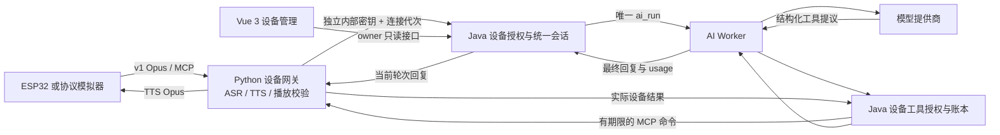

# ESP32 全 AI 交互：本批开发与验收

日期：2026-11-02。分支：`Dev`。对应 [开发计划](./ESP32_AI_ONLY_DEVELOPMENT_PLAN_20261102.md)。

本批实现设备协议安全、连接与命令账本、可信设备会话、唯一 AI Worker 执行和首批 MCP 工具；Vue 3 增加只读状态与会话入口。ESP32 采用 `ai_only`，服务端拒绝转人工、普通 App 消息注入和 App 实时会话接管。

这些新增能力默认关闭。原生 ESP32 服务没有切换到本批网关，视觉安全补丁也尚未在原服务生效；实体设备、真实业务 API、配网和 OTA 均未操作。完整技术验证、现有 Dev 的增量迁移与尚未完成项分别列出。

## 实际并行分工

| 子代理 | 模型 | 本批责任 |
| --- | --- | --- |
| `esp32_gateway` | GPT-6.1 Sol | Java 设备授权、连接 lease、命令、统一 AI 绑定、设备工具及迁移升级回归 |
| `esp32_sessions` | GPT-6.1 Sol | 会话与轮次、幂等和取消、真实 HTTP/模型闭环、模拟故障验收 |
| `esp32_protocol` | GPT-6.1 Terra | Python 协议/视觉安全、网关和播放校验、只读面板、CI 与有界页面修复 |

主任务负责共享 Java 的边界整合、Vue 3 设备页集成、独立浏览器验收、既有 Dev 数据保留检查及交付文档。工作区同期有另一 AI 全交互任务编辑共享代码；本批没有混合提交或推送其他任务的改动。

## 链路与责任

设备不能提交 owner、agent 或内部 URL 来取得权限。Java 读取现有绑定关系；Python 只有当前连接的转发权。一次输入只产生一条用户消息和一个有效 AI 任务；旧 Python LLM、意图工具和统一 Worker 不会在同一轮并行执行。

## 已实现

### 协议与视觉安全

- 移除 `web_test_client` 视觉鉴权旁路，保留合法视觉 token 格式，校验设备对应关系。
- 图片上限 5 MiB、视觉问题上限 8 KiB；读取时计数，超限明确失败。
- 支持当前原始 Opus v1，16 kHz 单声道、20/40/60 ms；不支持的 v2/v3 在握手时拒绝。
- 音频帧不超过 1275 字节，文本不超过 64 KiB，音频队列最多 100 帧；无合法 hello 不接收语音，过载关闭连接。
- 连接日志仅保留明确允许的设备/客户端/协议头，其余请求头脱敏。

### 设备管理和命令

- 注册、心跳、断开、在线状态与本次 MCP 能力发现。
- 持久化连接 ID、代次、网关 ID、绑定版本和 30 秒 lease；同一设备新连接替代旧连接，旧回调不能写新状态。
- 命令绑定当前设备与连接，严格允许列表、参数校验、幂等键、队列上限和超时。
- 允许 `self.get_device_status` 与 `self.audio_speaker.set_volume`，音量仅 0–100。
- 已派发而丢失回执的命令保持 `unknown`；不会因重试把控制命令重新派发。
- durable 授权 revision 覆盖绑定/MAC、智能体归属、用户启停与删除；解绑后再绑定、停用后恢复仍不能复活旧连接。
- 普通 alias、连接时间、智能体配置或用户名刷新不改变授权身份，同一连接、设备会话和历史持续有效。
- token cutoff 覆盖既有未来 30 秒时间窗；恢复授权后最多等待 31 秒再获取新 OTA token，旧 token 永久保持失效。

### 统一 AI 会话和工具

- 设备会话、网络连接、语音轮次分别建模；相同可信绑定重连保留会话。
- ASR 输入、输出记录、工具事件与重试幂等，输入事务回滚不会留下半条任务。
- canonical `ai_worker` 模式接入真实 AI 任务、模型调用、消息、用量与取消；禁止通过记录接口伪造模型完成结果。
- 首批 AI 工具为 `esp32_get_status`、`esp32_get_capabilities`、`esp32_set_volume`。音量工具仅在完整用户输入明确要求具体数值时开放。
- 设备工具单独持久账本，不把旧业务只读工具约束放宽；3 轮、6 次调用、30 秒预算，等待设备时不长期占用 SQL 事务锁。
- 工具提议、执行、回填、最终发布和语音转发均校验授权、任务尝试、轮次及连接代次。
- 新输入、abort、断线或撤权清理旧播放权限与队列，实际音频发送路径再次检查当前轮次。
- 普通会话历史、事件与 AI 任务读取也检查设备绑定，离线仍可读取有效历史，撤权后不能绕过专用接口访问。

`legacy_record_only` 保留可信记录协议；当前 Python 集成不运行不可取消的旧流式执行器。需要迁移实际设备时使用统一 `ai_worker` 模式，不能将记录模式当作可工作的 AI 回退执行器。

### Vue 3 与运维保护

- 设备管理行增加「AI 设备状态」；只有服务端声明 ESP32 能力后显示。
- 面板读取在线状态、MCP 能力和最近会话；显示统一会话编号与执行模式。
- 身份/设备切换立即清空旧数据，迟到响应不回填；后台轮询保留当前按钮节点，404 隐藏，其他故障显式提示。
- 修复空或异常固件版本导致整条设备行不显示的问题。
- 沿用全局导航与主题变量；不为 ESP32 页面设置独立菜单或绿色主题。
- CI 增加 ESP32 协议/网关测试与独立数据库准备；Dev 启动预检识别初版和新增严格撤权触发器迁移，权限条件不满足时在改服务前失败。

## API 与配置

详见 [网关配置与接口说明](../../main/xiaozhi-server/esp32_gateway/README.md)。公开能力入口为 `GET /api/v1/esp32/capabilities`，仅表示配置，不是运行就绪证明。

内部接口使用独立 `X-ESP32-Gateway-Key`，只接受精确 POST 路由、无查询参数、有界 JSON、固定字段和正确数字类型。用户 Bearer 与 AI Worker 密钥均不能替代网关密钥。

首批管理 API 采用设备 owner 授权；跨 owner 的管理员授权能力需要另外定义并验收。Vue 本批没有提供音量控制、重启或 OTA 按钮。

## 验收记录

### 自动回归

- Java 最终全量：**622 项 / 93 个套件**，0 失败、0 错误、0 跳过；包含初版 schema 升级与普通元数据更新不破坏会话/历史的回归。
- Vue 3：**517 项 unit + 10 项 contract**；6 种语言各 1937 keys 检查和生产构建通过。
- Python 独立最小依赖环境：AI Worker 73 项、realtime Worker 64 项、ESP32 18 项通过。其运行输出由 Terra 子代理回报，未保存成独立日志文件。
- Dev CI 数据库准备 4 项通过，覆盖真实 16 位和允许最大 24 位标签的 MySQL 名称长度与唯一性；含新触发器预检的 runtime 测试亦通过。

[最终矩阵结果](/Users/lengwang/code/esp32/work/esp32-full-matrix-20261102_111515_0a3f41/repo/main/manager-api/result.json) 含产物与源码 SHA256、22 个实际保留的独立测试库（含升级回归及同期新增实时输入模块）。独立快照通过 `-DskipTests=false package`，完成时与当前生产源码无差异。定向重跑不叠加计数。

最终 JAR SHA256：`00cd8842dd2e09fd0b8a0a9a0fde36e02e6edc0873a487605806747fbe093f25`。

### 实际 HTTP 与模型

[最终 HTTP 证据](/Users/lengwang/code/esp32/work/esp32-ai-20261102/http-20261102_031710_df4686/proof.json)：11 项通过，使用 622 项对应的最终 JAR、独立 MySQL/Redis、当前 Python Gateway 客户端与授权百炼模型；状态工具 1 次、真实 provider usage 2 次、回复 53 字已落库。

覆盖超大请求、伪造 owner、两种内部密钥互用拒绝、AI-only 限制、重复输入唯一 run、重连代次失效、真正更换 agent 后回调与通用历史拒绝，以及 Python 同轮 TTS/命令各执行一次。新增真实 alias/lastSeen 和设备、agent、用户元数据更新后绑定、会话与历史保持不变的正向断言。

模型请求为真实请求。ESP32、MCP 设备结果和 TTS 播放接收端为受控模拟；这不是完整真实 ASR/TTS 音频链或实体硬件声音验收。

### 模拟故障验收

[最终稳定性证据](/Users/lengwang/code/esp32/work/esp32-ai-20261102/http-20261102_031710_8547de/stability-proof.json)：8 项通过，耗时 75.58 秒，provider 调用 0 次。

- 双网关连接代次竞争和短断连重连。
- 真实等待 31.25 秒后 lease 自然失效。
- 只重启隔离 API，丢失 ACK 后重试仍为同一 command、同一终态审计。
- 新输入使旧任务 delta/complete 失效。
- 30 秒中 15 轮心跳、输入、取消，每次 input 对应唯一 run。

这是本批 ESP32 协议模拟验收；没有借用此前 App 的 30 分钟音视频结果，也没有宣称 ESP32 持续 30 分钟已验收。此前 616 项版本的 HTTP 与稳定性证据仍保留，最终以本节两个 622 项产物的 proof 为准。

### 浏览器

[UI 证据](/Users/lengwang/code/esp32/work/esp32-ui-20261102/ui-proof.json)：ego-browser 中通过真实隔离 API 展示模拟设备的在线状态、MCP 能力及 `ai_worker` 会话，修复后没有 JS 异常。此只读 UI 使用较早 613 项构建的 API 合约；不据此证明后续 token/迁移补丁已部署。

- [桌面截图](/Users/lengwang/code/esp32/work/esp32-ui-20261102/desktop-status.png)
- [390px 截图](/Users/lengwang/code/esp32/work/esp32-ui-20261102/mobile-status.png)：页面宽度 390px、弹窗 366.59px，未超出视口。

所有自建验收 API、Redis、Vite 和浏览器测试页结束后关闭；独立测试库保留。原有 Dev 与设备服务继续运行。

## 原 Dev 的增量升级与数据边界

只读核对发现，工作区另一并行任务已部署过初版 ESP32 迁移：原 Dev 为 128 个 changeset，授权表仍只有三列，但旧触发器引用新的 cutoff 列。本批不能直接修改已执行迁移内容来绕过这一状态。

修复方式为冻结与原记录 `8:d3e073f499bdd28deb94425a3b9eeb98` 一致的初版，新增两个有条件的列迁移和一个严格撤权迁移。新严格触发器先创建，再移除本模块的六个旧触发器；保留所有表和数据，不存在授权保护空窗。已有授权记录按保守策略推进 cutoff，新注册的初始记录仍保持兼容。

**原 Dev 增量升级已完成：128 → 131 个 changeset。** [迁移证据](/Users/lengwang/code/esp32/work/esp32-dev-cutoff-migration-20261102/migration-proof.json) 记录备份摘要、三个精确待迁移 ID、原 checksum 保留及逐列哈希比较结果；[执行结果](/Users/lengwang/code/esp32/work/esp32-dev-cutoff-migration-20261102/result.txt) 可直接核对。

迁移前后均保留：4 个用户、1 个 agent、1 个设备、25 条旧语音历史、13 个统一会话、39 条消息。其他既有 ESP32 账本为空，仍为空。早期只读快照为 37 条消息，同期并行任务正常新增的消息也包含在迁移前 39 条逐行保留检查中。

执行前在私有工作目录保留 589 KiB SQL 备份；没有删除、清空或重新初始化表、数据库、卷或迁移历史。专用 Liquibase runner 只加载迁移，既有服务持续运行，API/Vue 均返回 HTTP 200；MySQL 全局 trust 保持 0，临时连接凭据执行后移除。

迁移资源与最终 622 项 JAR 完全一致；runner 使用已冻结的 616 项基础依赖和独立迁移 overlay，精确限制只执行上述三项，避免夹带并行任务尚未应用的其他迁移。当前源码后来增加了两行「保留已应用迁移」注释，解析后的迁移内容与最终产物相同。

这里只修复了原 Dev 的数据库结构。ESP32 feature 仍默认关闭；没有替换同期任务正在使用的 API JAR，没有切换原生设备网关。后续部署完整新网关仍应单独执行灰度和运行验收。

## 尚未完成

以下仍不依赖真实 Laravel API，可继续开发或技术验收：

1. Vue 3 展示详细语音轮次、命令结果、工具审计、错误和分段耗时；当前只读面板只有状态、能力与会话入口。
2. 按设备灰度启用和一键回退编排，配置迁移核对与独立网关启动工具。当前是配置开关，尚未切换原设备服务。
3. 新网关连续至少 30 分钟、并发容量、ASR/TTS 慢响应、数据库/Redis故障和资源泄漏验收；逐包授权检查的性能优化须保留权限边界。
4. owner 之外管理员的明确授权策略、按设备/账号的持续速率与模型用量配额、运维指标与告警。
5. 生产配网、短期设备凭据、硬件身份或防 MAC 冒用设计；既有 OTA HMAC 不能替代该能力。
6. 摄像头拍照与统一会话证据关联；本批只修复既有视觉入口安全，没有完成该视觉整合。

仍需要外部条件的验收：实际 ESP32 唤醒、麦克风/喇叭、连续播放、回声噪声、打断、真实 Wi-Fi 及 OTA 回退；真实业务 API；公网 HTTPS/WSS 与生产密钥/网络策略。这些结果不能由模拟器、接口或构建替代。

后续继续按上述顺序在 `Dev` 开发，使用增量迁移，保留现有数据库。
