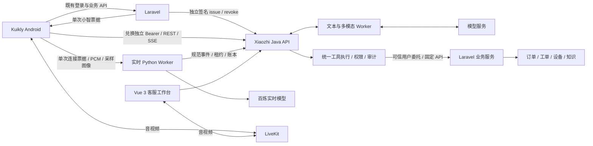

# Kuikly Android 与 Xiaozhi Server 联合接入需求

更新日期：2026-11-01。本文基于前端任务 `01a18088-1260-7c61-b6ff-24e1855ed3b6` 的最近完成记录，以及当前 Android、Laravel、Server 源码核对；属于开发与联调需求，未据此宣称 App 已接通小智。本文已纳入“Laravel 身份/业务 API + Xiaozhi 统一 Agent”的完整客户端交接要求，Kuikly 开发可按第 4、5、6、7、9 节实施；新增工具和确认协议尚待 Server 冻结，不能按规划名称直接请求不存在的接口。

## 1. 结论与接入顺序

后续架构明确为：Laravel 承担身份和业务授权/API，全部新 AI 对话、媒体与 Agent 工具编排在 Xiaozhi Server 完成；App 的新 AI 消息不再同时请求 Laravel 旧 AI 端点。订单等数据由 Server 根据可信用户委托按需查询，再统一回复。详细分层、工具执行闭环和分期见 [Agent 主服务与 Laravel 边界规划](AGENT_PLATFORM_LARAVEL_BOUNDARY_PLAN_20261101.md)。

**本次开发采用上述架构。** Laravel 不负责新小智会话的模型调用、提示词、流式 AI 回复或工具编排；仍负责用户/租户/项目权限、业务数据和业务规则。Kuikly 将用户的业务问题发给 Server，Server 选择并执行工具后回复；App 不解析模型的 function call 再自行调用订单 API。原有非 AI 业务页面继续使用 Laravel，旧 AI 历史和未迁移的 Aimeet 咨询保留独立 provider，不删除或按相同数值 ID 强行合并。

可以立即配合开发，不必等待设备、工单、知识库的真实业务 API。Android 已有可复用的首页、聊天输入区、视频浮层、原生 LiveKit、铃声和来电弹窗；Server 已有统一账本、多模态、AI 实时语音/VAD、人工接管和媒体转接。主要工作是统一身份、协议和媒体状态，并完成真实双端验收。

建议先完成：**可信登录 → 同一小智会话的文字/SSE → AI 实时语音与自动听音 → 人工接管和音视频**；图片/视频证据、画面采样、前台来电可沿各自模块并行推进。真实业务查询及工单写入后续接入。

本轮分析只在 Server 仓库新增本需求并更新待办索引，未修改 Android/Laravel 代码、运行配置或数据库。Android 工作区有大量未提交与未跟踪的既有开发文件，后续开发须保留，不以已提交的旧版本替代当前工作区。

## 2. 当前开发进度对照

| 功能 | Android 当前情况 | Server 当前情况 | 联合工作 |
| --- | --- | --- | --- |
| AI 首页与文字聊天 | AI 为主入口；草稿、历史、附件、本机失败消息、流式展示已做；仍调用 Laravel `/api/chat/...` | 小智统一会话、消息、任务、事件与认证 SSE 已实现 | 增加小智协议适配和会话映射，保留现有 UI |
| AI 实时语音 | 有实时入口、可选相机和静音展示；现有 AI 相机只在本机采样，尚无小智 PCM 链路 | P3 WebSocket、真实百炼、手动/自动 VAD、暂停/打断及恢复已验证 | 新增 Android 原生采音、播放与实时传输模块 |
| 图片/录音/视频理解 | 有选择、录音、上传及本机逐条重试；旧 Laravel OSS 上传仍保留待验收 | B3 私有上传、检查、派生、Omni 问答已验证 | 独立接 B3 上传状态与私有读取；Server S3 成功不证明旧 OSS 路径已修复 |
| 人工文字 | 有人工模式和公共输入区，调用 Laravel 动作/消息通道 | B1 接管、分配、消息、历史截止与恢复 AI 已实现 | 替换服务协议；保持小智 conversation，不仅改前端显示模式 |
| 人工/专家音视频 | 已有 Android LiveKit 宿主和旧 Aimeet consultation API | B5 支持客户或当前坐席发起、接听/拒绝、代次转接、清理 | 增加 B5 adapter、真实媒体 ready 和房间代次切换 |
| 来电与铃声 | 呼出等待音、来电铃声、接听/拒绝弹窗及受控前端验收已做；生产 transport 未接 | B5 已有当前会话查询和邀请/接听机制，不能笼统视为完全没有反向呼叫 | 当前人工会话可先接 B5；跨会话外部邀请发现、路由和旧 Aimeet 反向呼叫另补 |
| 登录与撤销 | Laravel 登录、旧 Aimeet SSO 已有；未找到小智 source issue/revoke adapter | 独立外部身份、来源/Bearer 绑定和媒体撤销已实现；Dev 外部入口默认关闭 | Laravel 新增可信签发/可靠撤销，App 独立兑换与退出清理 |
| 业务数据 | 现有 App 业务页面继续走 Laravel | 只读委托 adapter 已完成，真实生产者未接 | 不阻塞聊天/媒体开发；业务授权与真实数据另验 |
| Agent 工具与技能 | 尚无小智工具状态、来源引用和业务确认适配 | 已有固定只读 HTTP 客户端；工具目录、模型执行循环和实时工具事件仍待开发 | App 做统一展示/确认，Server 做工具选择、授权、执行和结果回填 |

前端任务报告 1082 项 JVM 测试及 2 项 USB 前端验收通过，记录在其 `.ai-task.md` 和 `2026-10-30-call-alerts-incoming-frontend.md`；本次没有重跑测试或重新验证手机。Server 弱网和长通话证据见 [专项验证](MEDIA_RESILIENCE_VALIDATION_20261101.md)，不能替代当前 Android 的真人与物理设备验收。

## 3. 接入架构与身份边界

采用以下分工，不整体替换 App 现有业务 API：

Laravel 保留现有认证与业务接口，新增小智独立票据生产者和撤销投递。App 用独立 Xiaozhi client 访问配置的 HTTPS API，使用 Server 返回并受部署信任配置限制的 worker WSS 地址；真人媒体由原生 LiveKit 连接受信 WSS。原 Laravel PAT 只发 Laravel，小智 Bearer 只发小智，模型密钥与来源签名密钥不得进入 APK。

### 统一 Agent 下的职责分工

| 项目 | 必须实现 | 不放在该层的职责 |
| --- | --- | --- |
| Kuikly Android | 登录票据兑换、专用小智 client、统一会话/事件、原生媒体、查询状态/结果/来源展示、明确业务确认 | 模型 API key、来源签名、模型提示词/工具执行循环、跨租户授权、自动执行模型提供的 URL 或 SQL |
| Laravel | 登录与来源会话、可信 tenant/scope、独立 issue/revoke、固定委托业务 API、资源权限与业务规则 | 新小智会话的 AI 回复、重复的模型代理或语音专用业务编排 |
| Xiaozhi Server | AI 与人工会话账本、多模态/语音、工具目录与技能、可信授权绑定、执行/审计、结果回填及统一回复 | 直接连接 Laravel 业务库，或用全局管理员身份代替用户委托查询 |

Laravel 只在 AI 接入阶段提供身份，不表示业务接口只检查“已登录”。每次 Server 查订单、设备或知识，Laravel 仍须验证有效来源会话、当前成员关系和具体资源归属；Server 同样不能仅凭模型传来的 ID 放行。

### 业务问题的端到端流程

以“查这张工单的处理进度”为例，App 只发送普通消息与用户已明确选择的业务引用，流程如下：

1. App 向当前小智 conversation 发消息，Server 保存后由模型提出 `get_work_order({work_order_id})`；工单不明确时先向用户澄清。
2. Server 从当前 run/response 的可信绑定恢复用户、来源会话、具体 Bearer、租户和 scope，验证工具与参数，不接受模型或 App 自报执行身份。
3. Server 使用固定适配器调用 Laravel 委托 API；Laravel 实时核对权限，返回允许字段、真实记录 ID 和观察时间。
4. Server 校验并记录结果，向模型回填，再沿原 SSE/实时语音通道回复；App 展示查询状态和来源引用，不创建第二个 AI 会话。
5. 查询期间退出、换账号/租户、撤销、取消或转人工，旧结果不能被展示到新会话或继续旧语音播报。来源失败或未配置时明确显示未取得结果，不调用旧 Laravel AI 来编造替代答案。

工具是一次具体动作，技能是组合工具的版本化流程。例如“故障初查”可组合设备档案、报警、知识和转人工。首期走现有固定 HTTP adapter，无需 Kuikly 或 Laravel 先实现 MCP；后续 MCP 也由 Server 统一接入，不在 App 增设工具执行器。

### 首批业务能力与客户端呈现

下表工具名均为规划名称，不是现有 HTTP 路由。订单与工单分开建模，不能把 `work_order` 当作所有订单。

| 业务能力 | Server/Laravel 需要补的部分 | Kuikly 需要实现 |
| --- | --- | --- |
| `get_device`、`get_work_order`、`search_knowledge` | 复用已有 adapter，补模型工具执行和真实来源 producer | 通用查询状态、结果摘要、来源/时间和授权引用 |
| `search_orders`、`get_order` | 新增明确订单类型、查询条件、分页和详情协议 | 复用结果组件；查看详情只按受信业务类型/记录 ID 走既有路由 |
| 遥测/报警查询 | 新增真实来源、采样时间、单位和陈旧标记 | 展示真实时间/单位、陈旧或部分结果，不把旧值显示为实时值 |
| 工单草稿 | Server 整理已确认事实与证据，草稿不写业务库 | 草稿预览、补充/修改，明确“尚未提交” |
| 工单提交等业务写入 | Server 确认流程和 Laravel 业务幂等/状态核对均就绪后开放 | 显式确认、提交中、成功/失败/结果不确定；不自动点击确认或重试写入 |

首期只读查询优先；取消订单、退款、派单等另定义业务确认与权限。AI 不自动控制危险设备，工具或技能增加不改变此边界。

### 身份接入的最低交付

1. Laravel 新增登录保护的“小智票据申请”接口，具体路由需与 App 冻结；该接口**待开发**。从真实用户、当前有效登录会话、当前租户和真实成员关系构造 subject/source_session/tenant/scope，签名调用 Server `POST /api/v1/external/identity/issue`。不接受客户端任意指定 owner、角色或授权设备集合。
2. App 以单次 ticket 调 `POST /api/v1/external/identity/exchange`，独立保管返回的 token 与 `expires_in`，用 `/me` 确认上下文。已有 Laravel HttpClient 与全局 baseUrl 不改为小智；新增限定目标 origin 的专用会话与传输适配。通过现有网络/Module 分层接入，不在页面散落平台 HTTP 调用。
3. App 切账号、切租户、切环境或退出时，停止采集、播放、SSE、WS、RTC 与铃声，取消旧异步回调；本机缓存按 provider、环境、账号、租户隔离，不上传或自动重发既有失败媒体。小智短票/RTC token 不进入普通离线消息缓存，认证凭据遵循现有安全存储策略。
4. Laravel 的注销、来源会话撤销和权限变化必须可靠投递签名 `/identity/revoke`，记录失败与重试。App `/identity/logout` 只撤当前小智 Bearer，不可代替来源端可靠撤销。
5. Server 侧配置独立来源密钥与 feature flags，签名遵循 [B6](B6_IMPLEMENTATION_CONTRACT.md)，不要复用 Aimeet SSO v1、Cookie、PAT、LiveKit key 或公开测试密钥。

**外部长通话限制必须提前进入产品与验收范围：**当前外部 Bearer 默认 300 秒、可配 30–900 秒，媒体绑定具体 Bearer。新 Bearer 不能接管旧媒体；内部账号的 30 分钟技术测试不代表外部 App 可连续通话 30 分钟。首轮按现行期限验证：提前显示到期提示、停止本地媒体、核对旧会话结束，在来源仍有效时重新认证并由用户确认发起新媒体。若目标是连续 30 分钟外部通话，Server 需另行设计并验收受来源约束的续授权机制，不能通过客户端偷换 Bearer、忽略到期或自动开麦规避。

## 4. Android 开发需求

### K1 / P0：统一会话与事件适配

- 新增 Xiaozhi API/DTO 与 conversation repository，复用现有聊天列表、输入框、草稿和逐条发送状态。推荐引用模型包含 `provider + remoteConversationId:String + account/tenant/environment scope`。旧 Laravel `Int conversationId` 与 Aimeet consultation UUID 不能塞进同一数值字段，不能凭相同 ID 合并历史或用户。
- 小智普通文字、实时 AI 与人工接管使用同一个 Server `conversation_id`；`support_request_id`、`media_session_id` 和 `room_generation` 独立存储。旧专家 consultation 与小智 conversation 保持明确映射或继续隔离，不伪造专家或替换接收方。
- 接入创建、列表、消息/事件增量、认证 SSE；以持久消息 ID 更新气泡，处理 delta/reset/completed/canceled，去重并记录最后成功处理的事件游标。SSE 断开后补拉，保留轮询兜底；停止生成须调用 run cancel，不能仅断开 SSE。
- 发送保留 `client_message_id` 与原 parts 顺序；超时结果不确定时先查状态，再按相同编号重试。所有业务 ID 保持字符串；epoch/房间代次按各自契约的 JSON 数值处理。不能把所有游标统一当 page/page_size。
- 能力声明未就绪前用明确部署配置分配路由，缺功能显示真实未开放状态，不自动回退成另一提供方或在同一次失败发送后同时请求两个后端。
- 新小智会话的文字、附件、生成停止/重试与历史均走 Xiaozhi；旧 Laravel `/api/chat/...` 仅用于仍保留的旧 provider。不能同一条消息同时发两个 AI 后端，不能将 Laravel PAT 发到小智，也不能在聊天内为回答问题绕过 Server 直接查询业务。

验收：同一小智会话完成文字问答、断流补拉、停止与重试；退出重进不重复消息，原草稿和旧 provider 历史保留，跨账号/租户不串流。

### K2 / P0：Android 原生 AI 实时音频与自动听音

- 通过 common `hardware/` 契约和 Android Module 实现 PCM 采集、重采样、播放与 WS；原有 M4A 录音/ASR 是另一条链路，不能直接当 P3 PCM 包发送。输入为单声道 s16le 16kHz，输出为 s16le 24kHz；采集、传输和播放队列有界，退出释放线程、音频焦点与资源。
- 查询 P3 capabilities，创建 session 时冻结 `manual` 或 `server_vad`，同时明确 microphone/camera consent。通过 connect-ticket 连接，首条 WS 消息为 `{type:"connect",ticket}`；URL 不放 Bearer/票据，不直连百炼。
- 区分 WS connected、模型 ready、听音、说话、AI 回复、等待取消确认、暂停、失败和终态。ready 或发现已有会话不能自动采音。
- 自动模式显式开始发送 `listening.start`；主动暂停立即停本地采集，发送 `listening.stop` 并等 `listening.stopped`。手动模式使用 audio.append/commit。处理 speech.started/stopped 和 authoritative cancellation，打断立即清播放队列，但模型取消结果以确认事件为准。
- 实现 ready 协商的应用层 ping/pong（当前 2 秒探测、发送后 6 秒匹配截止），不能仅依赖 TCP keepalive。网络失联、授权失败、epoch 冲突或结束先停本地资源；网络恢复不自动开麦、不重播未确认 PCM。显式恢复先确认旧 session 终态，再新建与重新同意。
- 文本消息经 REST 持久化与注入，区分已保存和模型已确认收到；实时期间非文字 parts 暂保留草稿，当前接口会拒绝 `REALTIME_TEXT_ONLY`。切人工后停止旧 AI 媒体并保留历史。
- 支持系统权限拒绝/撤销、耳机/扬声器与音频焦点变化、后台/锁屏及其他通话打断；首轮保持后台停止采集、回前台手动恢复，后台通话能力另开发。用真人声音实测回声、扬声器串音与误触发，不能以动画作为收音证据。

验收：真实 Android 麦克风→小智 worker→百炼→原生扬声器→持久账本；手动和 VAD 各多轮，包含静音等待、暂停、打断、弱网、过期和退出后的资源检查。

### K3 / P1：AI 画面采样接入

- 复用 CameraX 预览，新增受控的原生帧发送通路；当前 `AppAiDiagnosisCameraView.capture` 仅返回尺寸、大小和时间，不能据此声称图片已经发到模型。
- 相机默认关闭，只有明确授权后采样；创建 session 时未授予 camera，后续增加权限须按现契约结束旧 session 再重新同意。停止、后台、换会话和失败清空帧与发送队列。
- `frame.append` 为 JPEG base64，当前限制解码 921600 像素、图像 190000 字节、至少间隔 1000ms，且只在有效音频轮次已有音频输入后发送；按服务端能力/契约约束，不把原始视频文件发入该 WS。
- 当前 AI 是语音伴随采样图像，不能承诺 LiveKit 式连续视频理解、每帧持续看见或纯文字可靠追问旧画面。专家/人工真人视频与此保留独立 transport。

验收：真实现场画面与同轮语音关联、关闭镜头后不再传图；真实模型能回答可核验画面内容，保留结果和限制。

### K4 / P0：人工接管、B5 音视频与转接

- 对接 handoff、当前请求状态和统一消息/事件；只在 Server 真实状态下显示排队/已分配。用户端发消息沿用 conversation/messages，不调用只有客服可用的写接口。
- 使用 B5 create/accept/token/ready/end，并保留控制 epoch、当前/准备房间代次。适配新的 token DTO：小智返回 session/generation/participant identity，**不提供旧 Aimeet 必填的 room_name**；原生连接使用受信 server_url 与 participant_token，不能伪造 room_name 通过旧 parser。
- 修改 `AppRemoteRtcView.connect` 当前同时检查 CAMERA 和 RECORD_AUDIO 的逻辑：音频通话和 camera=false 时不得强制相机授权；相机开关必须同时遵守系统权限和服务端 publish_sources/原同意，不能本机打开即视为可发布。
- 原生桥增加本端与对端 participant SID、真实音视频收取/解码与连接状态，供 `/ready` 使用。当前仅有 connected/peer_present/receiving_audio，不能直接满足 B5 ready；入房、对端到场、实际媒体到达分别展示。
- 定时核对 current/session 与 member 授权，单次查询不重叠。对方主动静音、未发布摄像头与真实收不到媒体分别展示，不能将任意静音当断线，不能用 HTTP active 覆盖本机 RTC 断开。
- 转接由坐席发起，App 展示目标与客户 approve/reject，准备新代次连接和真实 ready；旧房与原服务不应在目标准备失败时被前端误结束。完成后不再复用旧房 JWT 或目标身份。
- 挂断先关本地设备和播放，再请求 end 并展示待确认/清理状态；挂断媒体继续原文字人工服务。保留原对话、草稿与附件，不能为了关闭视频调用结束人工或新建 AI 对话。

**已确认的 Server 配合缺口：**当前 owner cancel 仅支持 queued，active 服务须由坐席 resolve；owner 无法通过旧 App 的“结束人工并返回 AI”动作完成同义操作。首轮可以由坐席结束后 App resume-ai；若保留用户主动结束 active 人工服务按钮，需 Server 新增经过授权、并发安全、保留历史截止与媒体清理的结束流程后再启用，不在客户端假切成功。

### K5 / P1：私有附件、截图标注的接收与回传

- 接 B3 init→二进制 PUT→complete→processing/ready/failed，再绑定消息；选择文件、传输完成、检查完成和发送成功分开显示。使用稳定 upload/message 幂等编号，保留本机逐条重试和待确认状态。
- 外部 App 通过 `/api/v1/external/attachments/{id}/access` 获得绑定来源/Bearer 的短票；不使用旧 Laravel 公共 URL、匿名普通附件票、长期 OSS key 或任意外链作为证据。
- 接收客服发回的标注成图，展示并可追溯 annotation/frame/source，原文、画面与回复顺序一致。首轮 App 只需接收查看和补充原图/视频；若需要 App 自己画箭头/圈，再单列触屏编辑任务，复用 B4 不可变场景。
- App 发起实时抓帧若涉及 `/media-sessions/{id}/frames`，需注意该路径当前不在外部 Bearer 白名单；先由已支持的客服工作台发起，或由 Server 明确追加精确授权后开发，不能放开整个 support 前缀。

验收：真实照片/录音/视频完成上传、模型回答，客服截帧/标注返回后 App 可见；跨身份读取、过期短票、迟到响应均拒绝或明确失败，不覆盖原件。

### K6 / P1：前台来电 transport 与原会话路由

- 复用 `RealtimeCallInvitations.kt`、Ingress、来电弹窗和原生铃声 owner；新增真实 `RealtimeIncomingTransport`，不再用测试注入视作服务已接通。
- 当前小智 B5 已支持坐席向客户发起媒体邀请，用户已处在对应人工会话时，可结合 `/media-sessions/current?conversation_id=` 与会话事件先完成前台接听。accept 返回 Session 后再获取 token，转换为原生连接与可信 peer identity；不能用 token 冒充 accept。
- 现有 App Human 入口只接受当前人工模式且 conversation 一致；跨会话来电需要先验证身份/归属，显式引导进入原会话并保留草稿，再交付邀请，不把当前 AI 对话改名为客服。
- `GET /api/v1/support/media-invitations` 在本地坐席/客户 API 存在，但**不在外部 Bearer 白名单**。全局 App 来电发现需要 Server 补经过资源、source 和租户校验的外部发现接口/事件适配；不得简单开放旧邀请列表或使用管理账号给 App 查询。
- 旧 Aimeet Expert acceptance 强依赖 consultation/expert_id 和旧业务状态；小智 B5 由 support assignment/member 表示负责人，不伪造 Aimeet consultation。新增 provider 专用 acceptance 或明确迁移映射，保留旧 Aimeet 通路和 ID。
- 取消/拒绝/超时、接听与取消竞态、重复事件、迟到 accept 和换账号均停铃并重查权威状态；接听前不签发布 token、不开麦/镜头。邀请有效期使用服务端实际 expires_at，不能把前端 30 秒音效上限当服务端终态。

后台/锁屏/进程被杀后的来电，需另接推送、Android 通知与系统通话/前台服务及相应权限和生命周期，不在前台弹窗联调完成时宣称支持。iOS 原生 RTC 与系统来电也属于独立后续任务。

### K7 / P0：Agent 查询状态与结果展示；P2：业务写入确认

**客户端定位：**只负责展示 Server 的已授权状态与结果、收集用户输入和确认，不执行 function call、不维护模型工具清单或业务签名。新增业务工具优先复用同一套组件，避免每个工具都新增一条 App 到 Laravel 的查询链路。

- common 层新增独立工具展示模型与状态 reducer，通过专用小智 API/事件 adapter 更新；复用现有 DlUI、SSE 解析、消息列表与视图分层。展示模型至少关联当前 provider/account/tenant/environment、conversation、run/response、tool execution ID 和版本/序号，过期或其他会话的回调不得更新当前界面。
- 同一回答可能先查询再生成：展示“正在查询工单/设备/知识”等短状态，成功后继续原 assistant 消息；不能把每个工具步骤伪装成用户、客服消息，也不能在工具等待阶段提前标记整轮回答已完成。
- 支持等待、执行中、成功、失败、取消、过期、待确认和结果不确定等服务端状态；无记录、无权限、未配置、超时/限流、部分结果和陈旧数据使用真实语义，不全部画成空列表或成功。
- 结果组件展示经 Server 裁剪的摘要、真实资源 ID、来源、观察/采样时间、单位、陈旧/部分/截断标记和允许访问的引用。默认不展示原始 function 参数、内部日志、调用凭据或完整业务响应。
- “查看工单/订单/设备详情”按白名单业务类型和记录 ID，经 `AppNavigator.openUrl` 映射到现有受登录保护的页面；详情页继续自身业务权限校验，不直接打开模型/工具正文给出的任意 URL。
- SSE 重放和重连按执行 ID/版本去重；先补拉权威状态，再继续展示。停止生成、打断、切人工与退出沿既有 Server 控制协议，取消 UI loading 不能当作远端执行已取消。只读重试也必须由 Server 重新鉴权和限次执行，客户端不自行重放底层业务请求。
- 写入能力启用后，显示 Server 提供的操作对象、参数摘要、关键变更、到期时间和确认状态；用户明确确认/拒绝后提交该服务端确认引用。确认需在 Server 绑定账号、租户、工具/版本、参数摘要与有效期，字段或对象变化须重新确认。
- 提交中防重复点击；网络超时显示“结果待确认”并查询操作状态，不创建新幂等键再次提交，不把本地草稿或模型话术显示成已创建工单。语音触发写入同样使用明确确认流程，不能仅靠识别出的“好的”自动提交。
- 模型/工具能力关闭时保留普通聊天和明确未开放提示；工具查询失败不自动切回旧 Laravel AI。App 非 AI 业务页面由用户主动进入时仍可调用既有 Laravel API，与聊天工具执行保持边界。

**协议依赖与开发边界：**当前已有会话消息/事件/SSE，但尚无已冻结的公共工具状态、引用和业务确认 wire schema。上述字段是客户端模型需求，不是可直接调用的现有 JSON/端点；以第 6 节交接清单冻结后再接真实服务。Kuikly 可先实现 repository/adapter 接口、UI 状态 reducer、组件与显式标记的隔离测试样本，工具入口保持关闭；不得轮询猜测出的 `/tools`、`/skills` 或 `/api/realtime` 路由，也不把样本作为真实业务答案。

验收：同一个小智会话完成用户提问→真实查询状态→来源结果→最终文字/语音回答；重连不重复工具卡片，跨会话/账号/租户不串结果。写入另验明确确认、参数变化、重复点击和超时状态核对，真实 API 未就绪时保留未验收。

## 5. 双方任务与依赖

| 编号/优先级 | 负责人 | 具体交付 | 依赖 |
| --- | --- | --- | --- |
| L1 / P0 | Laravel | 小智 ticket 申请、可信租户/scope 解析、独立签名 issue、持久 revoke 投递及失败可观测 | 有效测试登录和独立来源密钥；不依赖温度/工单 API |
| S1 / P0 | Server | 冻结联调 API/worker/LiveKit 入口、独立来源配置、TLS 和开关；输出给 App 的部署配置/能力矩阵 | L1 对齐与已授权测试环境 |
| A1 / P0 | Android | 专用 Xiaozhi client、来源兑换与缓存隔离、K1 文字/事件/SSE | DTO 和协议可先开发；真实联调依赖 L1/S1 |
| A2 / P0 | Android 原生 + shared | K2 PCM/播放/WS/VAD/打断/心跳/恢复；复用当前浮层 | 与 A1 并行，实现后用真实来源身份验收 |
| A3 / P0 | Android + Server | K4 handoff/B5，最小权限纯音频、真实 ready、挂断续聊 | A1/L1/S1；与 A2 可并行 |
| S2 / P1 | Server | 用户结束 active 人工服务；外部邀请发现和跨会话路由所需的最小响应字段/权限；通用能力声明与错误语义 | 先冻结补充接口，不把拟议路由写成已实现 |
| A4 / P1 | Android | K3 图像采样、K5 附件与标注接收、K6 真实前台来电 adapter | 相应 Server 协议与 S2 已明确的部分 |
| S4 / P0 | Server Java + Python | 工具目录/Schema、来源授权绑定、持久调用与尝试、文字工具执行/回填、公开状态与来源引用协议 | 可先做隔离协议/故障测试；真实查询依赖 L2 |
| L2 / P0 联调依赖 | Laravel | 固定签名只读委托入口，优先 device/work_order/knowledge，逐次复核来源/租户/资源权限 | 复用现有业务服务；没有真实测试 API 时保持实际业务未接通 |
| A5 / P0 | Android shared + UI | K7 通用工具状态、结果/来源展示、去重与授权隔离；新 AI 消息全部走 Server | 组件/隔离样本先做，真实 adapter 等 S4 wire schema 冻结 |
| S5 / P1 | Server 实时 Worker | P3 工具事件、ACK、结果回填、续答和打断；共用 S4 权限与审计 | S4 工具契约稳定；真实 provider 与 Android 验证 |
| A6 / P2 | Android + Server + Laravel | 工单草稿、明确业务确认、提交结果/不确定状态，订单/遥测等业务扩展 | Server 确认协议及来源业务幂等/查询接口就绪后启用 |
| S3 / P1 | Server + 来源认证 | 如需连续 30 分钟外部媒体，设计受来源约束的续授权方案并验证撤销、并发与过期 | 当前 300–900 秒凭据约束须先确认产品目标 |
| J1 / P1 | Android + Server + 客服测试端 | 真实双端及现场验收矩阵，记录通过/失败/未测 | 各模块真实接通；不能用模拟登录替代来源授权 |
| B1 / 后续 | Laravel 业务 + Server | 订单类型与搜索/详情、遥测/报警、工单关联/提交/派单，扩展已有工具审计 | L2 三类只读查询先行；其他真实业务 API 与授权另冻结 |

可将 A1、A2、A3 分成相互独立的前端开发任务；Server 与 Laravel 同步做 L1/S1/S2。大模块可以按用户偏好由 6.1 Sol 开发，DTO/契约测试与文档等有界小任务由 6.1 Terra 配合。本次为需求分析，未新派发代理或向其他聊天发送消息。

工具相关开发由 S4/L2/A5 并行，文字闭环稳定后再推进 S5 实时工具；A6 受控写入保持独立发布开关。当前已完成的是基础聊天/媒体及身份和只读 adapter，不把本表新增 Agent 工作算作已完成。

## 6. 联调接口速查

路径不含部署 servlet context，当前 Server 常用 context 为 `/xiaozhi`。地址通过环境配置提供，手机上的 `127.0.0.1` 不是 Mac；USB 测试需明确反向端口或专用 LAN/TLS 入口，不能将后台 localhost 页面可打开当 App 可达。

| 能力 | 现有 Server 入口 | App 处理要点 |
| --- | --- | --- |
| 外部身份 | `POST /api/v1/external/identity/exchange`；`GET /me`、`POST /logout`（同前缀） | 不接受 Laravel PAT 直接作为小智 Bearer |
| 会话与账本 | `/api/v1/ai/conversations`、`/{id}/messages`、`/{id}/events`、`/{id}/stream` | 认证 GET SSE；after/before 游标分工见契约 |
| 停止/重试 | `/api/v1/ai/conversations/{id}/runs/{runId}/cancel`、`/retry` | 操作持久 run；断开 UI 流不是取消生成 |
| AI 实时 | `/api/v1/ai/realtime/capabilities`、`/sessions`、`/{sid}/connect-ticket|messages|interrupt|end` | 后四项位于 `/api/v1/ai/realtime/sessions/{sid}`；WS 首帧 ticket |
| 人工接管 | `/api/v1/ai/conversations/{id}/handoff`、`/resume-ai`；`/api/v1/support/requests/{rid}` | 排队取消与 active 结束权限不同 |
| 人工媒体 | `/api/v1/support/media-sessions`、`/current`、`/{mid}/accept|reject|token|ready|end` | 所有 session 操作带各自契约所需 epoch/代次；不可调用内部坐席接口 |
| 转接 | `/api/v1/support/media-transfers/{tid}`、`/{tid}/approve|reject|cancel` | 客户可审批已授权的转接，不能冒充目标坐席 accept |
| 附件 | `/api/v1/ai/uploads/init`、`/uploads/{id}/content|complete`、`/attachments/{id}` | PUT 原始字节；ready 后才发送 attachment_id |
| 私有读取 | `/api/v1/external/attachments/{id}/access?variant=...` | 访问票据绑定当前 source 与 Bearer，过期重新授权 |

详细字段以 [OPENAPI](OPENAPI.yaml)、[实时 AI](REALTIME_AI_CONTRACT.md)、[外部媒体/VAD](EXTERNAL_MEDIA_VAD_OPERATIONS.md)、[B3](B3_IMPLEMENTATION_CONTRACT.md)、[B4](B4_IMPLEMENTATION_CONTRACT.md) 和现行控制器为准；早期批次文档中“未实现”的历史表述需结合后续验证阅读。

### 新增 Agent 协议的冻结清单（待 Server/Laravel 提供）

| 交接项 | 需要明确的信息 | Kuikly 接入要求 |
| --- | --- | --- |
| Laravel 小智票据申请 | 实际路径、认证方式、当前租户选择、票据响应与错误/撤销语义 | 使用原 Laravel client 申请，再由专用 Xiaozhi client 兑换 |
| 工具能力声明 | 已开放的文字/语音工具展示能力、协议版本、确认能力与降级规则 | 未声明或关闭时不猜测接口、不展示可执行的写入按钮；现有 P3 capabilities 不等于已有全局工具能力声明 |
| 工具状态与补拉 | 执行 ID、conversation/run/response 关联、版本/事件顺序、状态枚举、SSE/历史恢复与取消语义 | 以明确 schema 编写 DTO/reducer，不能解析自然语言猜测执行状态 |
| 结果与来源引用 | 授权摘要、类型化业务引用、真实时间/单位、陈旧/部分/截断标记、可查看字段 | 映射到通用结果组件；不读取内部原始响应或接受任意跳转 URL |
| 业务写入确认 | 服务端确认引用、账号/租户与参数摘要绑定、到期/版本、确认/拒绝和执行状态查询 | 先冻结再开发实际提交 transport；未知结果先查状态，不能重复创建业务操作 |
| 错误与取消竞态 | 未配置/无权限/无记录/故障的区分，撤销与迟到结果、切人工与中断的权威终态 | 失败/未测如实显示，不自动换身份、换 AI 后端或重发底层 API |

上表均为需交付的协议要求，本文不将任何建议工具名称、事件名、状态模型或确认字段宣称为当前已实现 API。Laravel 来源接口供 Server 调用；App 不因获知其路径而承担 function call 执行。

## 7. 真实联合验收清单

- [ ] 真实 Laravel 登录签发小智票据，App 兑换并进入本人/当前租户；来源退出或撤销后，SSE、附件、AI 和真人媒体按当前绑定收敛。跨租户、账号和环境不得串历史或复用 token。
- [ ] 新 AI 消息、附件和停止/重试只发送 Server，不请求旧 Laravel AI 回复；原有非 AI 业务页面和旧 provider 历史仍可按各自权限使用。
- [ ] 一次自然语言业务问题由 Server 发起真实工具调用，Laravel 按真实委托身份查询，App 显示执行状态、来源/时间和原会话内的最终答案。App 不自行执行函数、模型 URL 或业务 SQL。
- [ ] 工具事件重复、SSE 补拉、弱网、取消、换账号/租户、转人工和撤销期间不重复卡片、不跨会话播报；无记录、无权限、未配置、失败、陈旧和部分结果分别呈现。
- [ ] 业务写入在独立阶段验收：原草稿不显示为已提交，确认绑定参数和账号/租户，参数变化重新确认；连点/超时/进程重启后查询权威状态，不重复提交。
- [ ] Android 与 Vue 3 客服工作台使用同一小智 conversation，完成文字→AI 实时多轮→转人工→媒体挂断后文字→人工结束后恢复 AI；核对持久消息与草稿，无重复或冒名回复。
- [ ] 真实麦克风、扬声器、耳机及摄像头验证手动/VAD/暂停/打断/镜头开关，拒绝相机仍可纯音频；后台、网络断开和退出后确认实际采集停止。
- [ ] 客服主动邀请 App：响铃→拒绝/接听/取消/超时，另一端同步终态；接听后真实双向音视频，不能以弹窗、入房或累积计数替代播放/解码证据。
- [ ] 转接同一业务会话至另一真实授权坐席，客户确认、新房 ready、历史 cutoff 和旧 JWT 隔离正确；目标失败不误终止旧服务。
- [ ] 真实照片/录音/视频上传、模型理解、客服截图/标注返回，在 App 可读且来源可追溯；原件和失败本机媒体保留。
- [ ] 实际 Wi-Fi/蜂窝、TLS/WSS/TURN、断网/恢复、REST/provider/存储故障验证；区分信令在线与真实 RTP。默认短 Bearer 的到期行为先完成，连续 30 分钟外部通话仅在续授权设计完成后单列验收。
- [ ] 开发检查覆盖共享 Kotlin、原生生命周期、协议/竞态/身份测试与 APK；Android 真机、iOS 宿主、真实业务和生产部署分别记录，不能互相替代。

任何开发与验收均不得删除、清空、重新初始化或覆盖导入现有数据库，不得修改历史迁移 checksum、清空旧 OSS/S3 前缀或删除原有失败消息/录音。需要 schema 变化时只做可审查的增量迁移、备份和独立测试库；本需求不授权生产发布或全局网络改动。

## 8. 源码核对位置

Android 仓库：`/path/to/user/code/ui_aichat/aichat_plus_kuikly`。

- `shared/src/commonMain/kotlin/com/examplebusiness/app/network/api/ChatApi.kt`：现有 Laravel AI/私聊协议和 Int 会话模型。
- `shared/src/commonMain/kotlin/com/examplebusiness/app/network/api/NativeRemoteApi.kt`：旧 Aimeet consultation、connection 和 native 代理协议。
- `shared/src/commonMain/kotlin/com/examplebusiness/app/pages/ChatWorkspaceFrontend.kt`、`RealtimeCallInvitations.kt`：公共工作区、原会话约束和来电 transport 入口。
- `shared/src/commonMain/kotlin/com/examplebusiness/app/ui/components/DlRealtimeCallOverlay.kt`、`androidApp/src/main/kotlin/com/examplebusiness/app/AppAiDiagnosisCameraView.kt`：当前本机 AI 画面和未接通的音频视觉控制。
- `androidApp/src/main/kotlin/com/examplebusiness/app/AppRemoteRtcView.kt`：LiveKit 连接、双权限检查、peer 与音频统计回执。
- `docs/contracts/realtime-call-incoming-v1.md`：旧前端建议 call-session 协议；`/api/realtime/...` 是建议路径，不是当前 Server 已实现接口。

Laravel 仓库：`/path/to/user/code/ui_aichat/aichat_laravel`；核对 `routes/api.php`、`app/Services/AimeetNativeService.php` 与 `app/Http/Controllers/Api/AimeetNativeController.php`。本次在 app/routes/config 未找到小智 issue/revoke 或 `/api/realtime` 实现，旧 Aimeet native 代理仍存在。

Server 仓库：本需求所在仓库；核对 `ConversationController/Models`、`RealtimeController/Service`、`supportmedia/MediaController/Service/Models`、`support/SupportService`、`externalidentity/ExternalPathPolicy` 与 `realtime_worker/session.py`。Vue 3 已有 `realtime/session.mjs`、`realtime/browserMedia.mjs`、`apis/module/realtimeClient.mjs`、`mediaClient.mjs` 可作为协议与状态行为参考，原生 PCM/RTC 生命周期仍需 Android 自己实现和实测。

## 9. 给 Kuikly 开发任务的直接执行说明

本节可直接作为前端开发交接要求，前述现有原生媒体、草稿、失败消息、来电组件及源码约束全部保留：

1. **先完成 A1/K1**：新增独立 Xiaozhi client、身份兑换/到期/退出清理和 provider 会话引用；普通聊天、历史、认证 SSE、停止/重试与附件沿小智协议实现，保留现有页面和原 provider 数据。Laravel 原 client 继续服务登录和非 AI 页面，新 AI 消息不双发、不跨提供方自动降级。
2. **并行完成 A2/A3**：通过 common hardware/原生 Module 接 P3 PCM/VAD/播放/心跳与 B5 真实 RTC/ready/代次；共用现有全屏/收起和来电组件。权限最小化、相机默认关闭，后台/断网/结束停止本地媒体，恢复重新确认。
3. **先做 A5/K7 的可独立部分**：repository/adapter 接口、通用工具状态 reducer、查询/结果/来源/错误组件及隔离样本测试。公共工具 schema 尚未冻结时不硬编码猜测路由，不调用 Laravel 来代替 Server 执行工具；等待 S4 后补真实 DTO 和 transport，完成后再启用入口。
4. **随后完成 A4 与真实工具联调**：图片/视频私有证据、画面采样、标注接收、前台来电；使用真实登录与受授权数据，核对 Server 工具状态、结果引用和语音续答。没有业务测试 API 时如实标记业务联调未完成，不用演示数据冒充查询结果。
5. **A6 写入后置**：先展示工单草稿与确认组件，只有确认/提交/结果查询协议及 Laravel 幂等接口实际交付后才开放写入。App 不保存来源签名密钥、模型 key，也不自行实现领域 Agent 决策。
6. **提交验证记录**：遵循 Kuikly 仓库 AGENTS/CLAUDE 与现有分层规则；运行 Android 共享编译、相关协议/竞态/身份单测、Debug 构建，并在真实 Android 与 Vue 3 客服端验收登录、聊天、媒体、工具和退出恢复。每项区分已实现、受控测试通过、真实来源已接通、真机已验收；iOS 与生产部署单列，不凭 Android 编译通过代替。

本文件是跨项目开发需求，不表示其拟议接口已部署，也不要求修改或初始化任何现有数据库。接入方可先完成上述不依赖真实业务 API 的客户端部分；身份生产者和协议未就绪的真实调用保持禁用并列出明确依赖。
