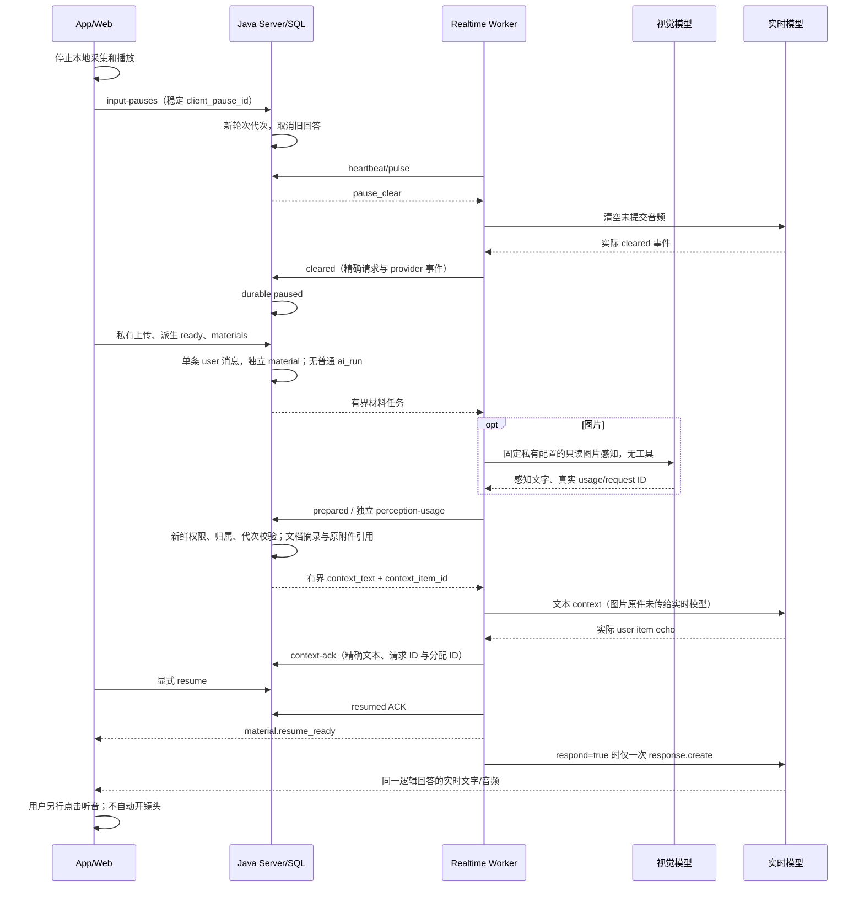

# A5 实时会话补充材料契约

公开接口规范：[AI_REALTIME_MATERIALS_OPENAPI_20261102.yaml](./AI_REALTIME_MATERIALS_OPENAPI_20261102.yaml)。

日期：2026-11-02。状态：已实现，真实 HTTP/Provider、完整独立浏览器流程与 Dev 增量部署完成；终版长测约20分钟出现上游错误，用户已要求停止追加长验收，手机/物理声学和生产验收仍单列。以同批 Java DTO/严格解析器为准，不改既有实时数值字段或普通消息入口。证据见 [本批交付记录](AI_FIRST_DELIVERY_20261102.md)。

## 范围与输入顺序

同一 `conversation_id` 内，由用户显式暂停后补文字、图片、TXT/PDF，再恢复实时回答。普通实时消息入口的 `REALTIME_TEXT_ONLY` 防护保留。相机、麦克风不自动打开，不支持边说边投材料。



真实探测中，原生 realtime mixed `input_text + input_image` 虽得到 item ACK，随后 response 报错；因此首版明确使用独立视觉感知步骤。ACK 不被当作模型成功理解图片的证据。图片感知文字附模型名、原附件引用和“不把原图传给实时模型”的说明，属于不可信观察，不能提升工具权限或冒充业务核验结果。

## 开关与能力协商

- 默认关闭：`features.realtime-materials-enabled=false`。依赖已有会话、附件、实时工具与工具授权能力；缺少当前实时绑定时不启动材料流程。
- `/api/v1/app/capabilities`：`features.realtime_materials` 和 `interaction.capabilities.realtime_materials`。后者 `implementation=implemented`、状态为 `disabled` 或 `verification_required`，仅说明配置。
- `/api/v1/ai/realtime/capabilities`：新增 `supports_materials` 和 `materials` 限额。旧客户端可忽略新增字段。
- Dev 在新包验证后通过 `python3 dev/manage.py ai-first-enable --technical-local --materials` 显式启用。仅复制现有私有视觉配置到私有 realtime worker，保留 realtime 模型/端点/密钥；不从任务或 App 接收模型 URL/密钥。

## 公开 HTTP

统一前缀 `/api/v1/ai/realtime/sessions/{session_id}`，沿用现有 owner、具体来源/token、控制 epoch 和撤销校验。外部 Bearer 仍走实时媒体授权，不因新增路径绕过原守卫。成功响应为 `{code:0,data:...}`，错误使用真实 HTTP 状态。所有下列 POST 不接受 query，JSON 最多 32768 字节，拒重复字段、未知字段、尾随内容和错误数字类型。

| 方法/路径 | 请求 | 返回 |
| --- | --- | --- |
| GET `/input-state` | 无 query | `State` |
| POST `/input-pauses` | `expected_epoch`, `client_pause_id` | `PauseView` |
| POST `/input-pauses/{pause_id}/resume` | `expected_epoch`, `client_resume_id` | `PauseView`，进入 `resuming` |
| POST `/input-pauses/{pause_id}/cancel` | `expected_epoch`, `client_cancel_id` | `PauseView`，重新 clear 或安全结束不确定上下文 |
| POST `/materials` | `expected_epoch`, `pause_id`, `client_material_id`, `parts` | `{message,material}` |
| GET `/materials/{material_id}` | 无 query | `MaterialView` |

客户端 ID 长度 1～64，必须稳定重用；相同 ID 和请求体幂等，不同请求体冲突。`parts` 复用普通 `MessagePart` 的 `text/image/file`，附件 ID 使用十进制字符串。上传必须同会话、当前 owner 上传、`ready` 且尚未绑定其他消息。提交失败不删除上传原件；不对普通 Worker 创建第二份正式任务。

```json
{
  "expected_epoch": 1,
  "pause_id": "00000000000000000000000000000001",
  "client_material_id": "stable-material-1",
  "parts": [
    {"type":"text","text":"请结合这张图片继续说明。"},
    {"type":"image","attachment_id":"2117000000000000001"}
  ]
}
```

`PauseView` 为 `{id,session_id,status,turn_generation,created_at}`；`MaterialView` 为 `{id,session_id,pause_id,message_id,status,turn_generation,error_code,context_truncated,created_at}`。`turn_generation` 沿用实时协议 JSON number；标识和时间使用字符串。

`State` 为 `{phase,pause,material}`，后两者可空。`phase`：`live/requested/paused/processing/prepared/context_acknowledged/resuming/failed/ended`。Pause status：`requested/paused/processing/prepared/context_acknowledged/resuming/resumed/failed/ended`；Material status：`queued/dispatched/prepared/acknowledged/failed/canceled`。

只有实际 clear 被持久确认后才允许提交材料；只有材料上下文被持久 ACK 后才允许恢复并回答。没有材料或材料已失败/取消时，可以清空确认后空恢复，`respond=false`，不创建模型回答。完成恢复后 `phase=live`、`pause.status=resumed`，保留最近 pause 与材料记录。

## Worker 与实时 ACK

内部前缀 `/internal/realtime-worker/sessions/{session_id}`，沿用专用 `X-Realtime-Worker-Key`，不赋予公开 API 用户身份。下列 POST 同样执行 32 KiB 原始 JSON 严格解析：

- `/input-pauses/{pause_id}/cleared`、`/input-pauses/{pause_id}/resumed`。
- `/materials/{material_id}/prepared`、`/perception-usage`、`/context-ack`、`/fail`。
- 固定内容入口：GET `/materials/{material_id}/attachments/{attachment_id}/content?variant=display`，`X-Realtime-Lease` 必须匹配实际 dispatch，限已选 JPEG，不接收任意 URL。

一般回调包含 `lease_token/control_epoch/turn_generation`，clear/context ACK 额外绑定 `provider_session_id/provider_event_id` 与具体请求/响应 item ID。会话、来源、lease、代次或材料状态改变后，旧结果不得注入、恢复或发布。

`perception-usage` 是特殊审计入口：仅允许原始派发 lease/epoch/generation、原材料和原附件写一次已观察 usage/request ID。撤销或取消后仍可记录已发生费用；响应不含正文、不授予上下文使用权。`prepared` 另做新鲜授权后才接受感知文字。未知用量保留 null，不填零。

WS `material.resume_ready` 包含 `session_id/control_epoch/pause_id/material_id/turn_generation`；仅已 acknowledged 且 `respond=true` 时 `material_id` 非空，空恢复即使状态保留失败材料也发送显式 null。顺序固定：Java resumed ACK → WS ready → 必要时一次 response.create。客户端以匹配 WS 与权威 `phase=live/pause.status=resumed` 双确认解锁，仍保持本机采集关闭。

### 浏览器采集代次协商（A5/A8 补充）

HTTP 暂停/恢复与客户端 WebSocket 音频走不同通道；停采之前排队的尾包可能在恢复之后才抵达。仅在暂停阶段拒绝输入不足以隔离旧录音。因此支持材料的新客户端在首帧 `connect` 附加 `capture_protocol: "material_capture_v1"`，Worker 在初始 `ready` 及每次持久恢复后的 `material.resume_ready` 返回同名协议字段和新 `capture_token`。令牌为会话内随机的 32 字符 `[A-Za-z0-9_-]` 串，只用于采集代次隔离，不能替代原 ticket、Java lease、来源授权或 control epoch。

协商后，`audio.append`、`frame.append`、`audio.commit`、`listening.start`、`listening.stop` 必须携带 `capture_token`；ping 不变。客户端在创建采集器时固定该次令牌，异步 PCM/JPEG 回调不能在发送时读取最新令牌为旧内容重新贴标签。只有完全匹配原会话、pause、material、turn_generation 的恢复 ACK 能更新客户端令牌；恢复不自动开启设备。

Worker 对结构/大小合法的暂停尾包和已知旧令牌输入做有界丢弃，不转发、不开启新轮、不改变清空状态。最多保留 24 个旧令牌；每段丢弃最多 64 包、2 MiB。缺失/未知令牌、非法媒体、越权摄像头或超过丢弃预算仍明确失败；暂停期使用当前令牌主动 commit/listening 不被当作恢复许可。旧的纯实时任务保持原协议；旧 A5 客户端未协商却请求材料控制时，以 `MATERIAL_CAPTURE_PROTOCOL_REQUIRED` 安全终止，不能静默恢复到有旧尾包风险的模式。

字段及本地 JSON schema 另见 `main/xiaozhi-server/realtime_worker/capture.schema.json` 与 Worker README。该补充不改变上述材料 REST 路径、数值类型和原有双确认条件。

## 资源与故障边界

每次最多 3 个 parts、2 个附件和 4000 字符用户文字。图片每张最多 1 MiB、使用真实 JPEG 派生；文档读取已有验证的 text 派生，每份最多 8000 字符，总 context 最多 12000 字符并标记截断。每 session 最多 6 次材料、12 张图片、20000 已知感知 token。

图片感知首版精确允许本地配置 `qwen3.8-flash`，固定受信 Bailian HTTPS 地址、20 秒超时、500 输出 token（配置范围分别不超过 25 秒、1000 token）。HTTP 只读感知不开工具；结果归独立 perception 账本，不伪造普通 run 或第二条 assistant。

未 ready、归属不符、材料超限或感知失败有明确错误；不声称已看完不可提取文件。prepared 后 context ACK 不确定时，取消通过结束并显式重建实时 session 收敛，不冒险把迟到 context 留在后续轮次。断线后先读取权威 State；不盲目重发恢复、旧 PCM 或新 client ID，不自动打开设备。

本契约描述实现边界。最终 Java/MySQL、Worker、真实 provider、Vue 和手机各层通过情况另记交付文件，不能以 fixture 或协议冻结代替验收。
